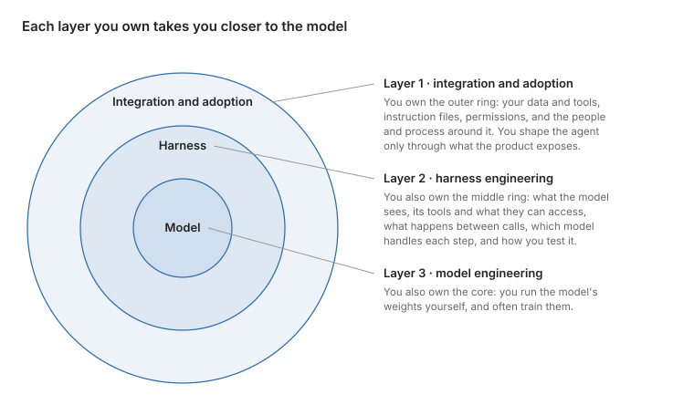
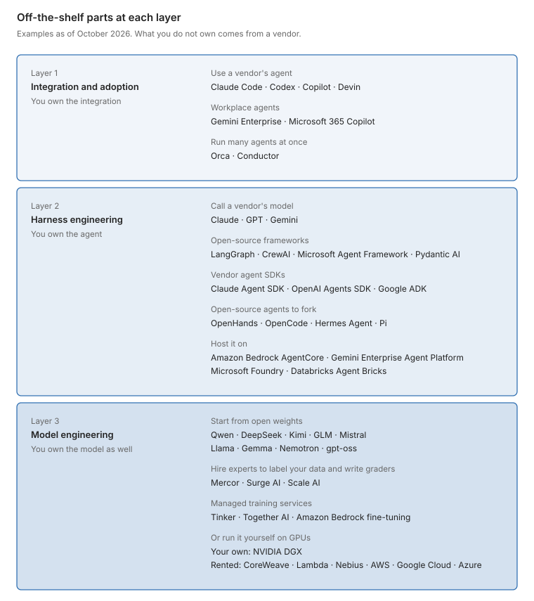
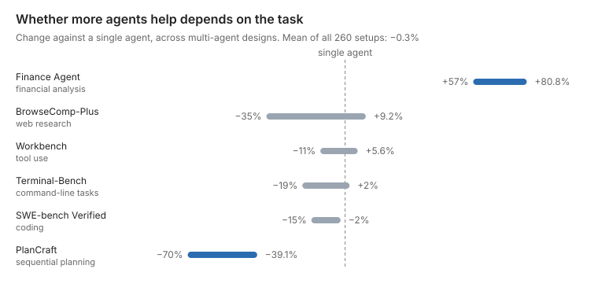
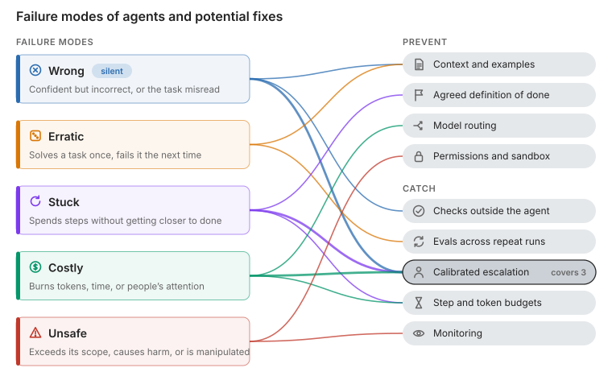
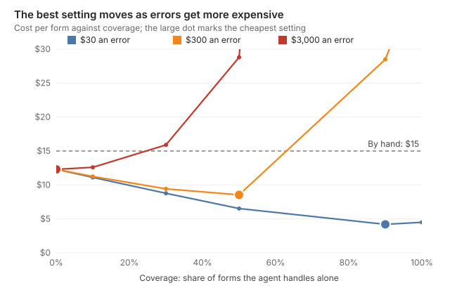
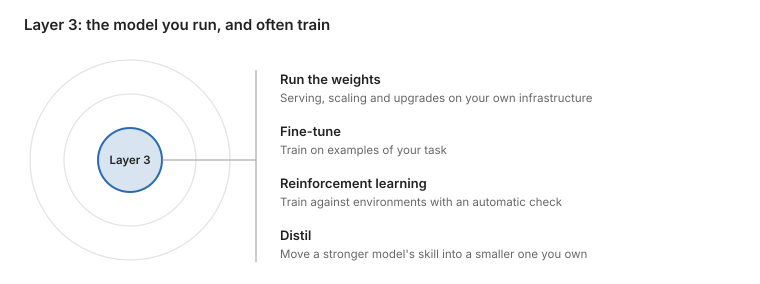
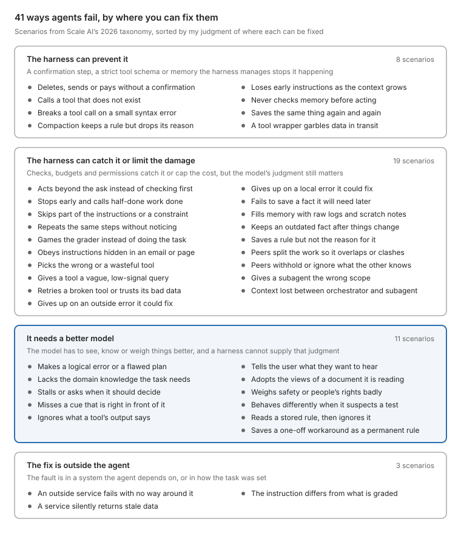

<!-- Review copy for comments and edits: https://claude.ai/code/artifact/b3bcc840-b1d6-4b44-889e-15f5275c454b (Claude Docs). This file is the source; review edits are synced back here and committed. -->

## TL;DR

- Off-the-shelf agents make people faster, but the business gains only when the work is redesigned around them.
- Build your own agent when it should run part of a process rather than assist one person. How much of the process to hand it depends on what an uncaught mistake would cost you.
- Own the model when harness work stops helping and frontier model APIs still fail your task, cost too much at your volume, or your data cannot leave your walls.
- Whatever you do, build an eval from your own tasks. It outlasts every model and harness around it.

Agents are in the headlines. They are settling open math problems, finding better materials, and writing much of the code at some companies. In January 2026, OpenAI's GPT-5.2 Pro and Harmonic's Aristotle [resolved an open Erdős problem](https://arxiv.org/abs/2601.07421), and a few months earlier MIT's CRESt [found a better fuel-cell catalyst](https://news.mit.edu/2025/ai-system-learns-many-types-scientific-information-and-runs-experiments-discovering-new-materials-0925) after more than 900 experiments. Yet when you bring an off-the-shelf agent to your own work, it misreads your data, trips over your permissions, or reports a task as done when it is only partly done. What the headline agents had, and yours lacks, is a strong model inside a system built for that one problem. A proof checker, Lean, verified every step of the Erdős proof, and robots made and tested the catalysts CRESt proposed. Part of the gap is the model, and part is that system. This post is my framework for deciding how much of that system to build, and when to own the model too, drawn from what I have seen customizing agents in my own work.

A common definition of an agent is [model + harness](https://www.langchain.com/blog/the-anatomy-of-an-agent-harness). The harness is everything around the model: the instructions and context it is given, its tools and what they can access, the workflow that coordinates its steps, and the tests or reviews that should catch its mistakes. As [one 2026 paper](https://arxiv.org/abs/2603.28052) puts it, the performance of LLM systems "depends not only on model weights, but also on their harness." The agent works inside an environment: the systems and data it acts on, such as a codebase, a CRM or an outside API. The environment needs work too. When an OpenAI team built a product with no hand-written code, early progress was slower than expected, ["not because Codex was incapable, but because the environment was underspecified."](https://openai.com/index/harness-engineering/)

People often debate which matters more, the model or the harness. Across model generations, the model wins. SWE-bench scores went from under 5% when the benchmark launched in late 2023 to over 80% by late 2025[^swebench]. On SWE-bench's [bash-only leaderboard](https://www.swebench.com/), where every model gets the same minimal agent and only a shell, GPT-4o solved 21.6% of tasks and Claude Opus 4.5 solved 76.8%. No amount of prompt polish would have closed that gap. Among today's top models the differences are small: in the leaderboard's February 2026 run, six models from five labs scored within four points of each other. Here the harness can matter as much. LangChain moved its coding agent from 52.8% to 66.5% on Terminal-Bench 2.0 by [changing only the harness](https://www.langchain.com/blog/improving-deep-agents-with-harness-engineering) around a fixed model.

A better model can make some of your harness unnecessary. Usually it is the parts that work around a model's weak spots; Anthropic writes that harnesses ["encode assumptions that go stale as models improve"](https://www.anthropic.com/engineering/managed-agents). Parts that give the model access to your data and systems are more likely to keep their value, if what they reach is well organized. When Vercel cut its data agent down to plain file access, it worked only ["because our semantic layer was already good documentation"](https://vercel.com/blog/we-removed-80-percent-of-our-agents-tools).

Customizing an agent can mean three kinds of work: connecting an off-the-shelf agent to your data and tools, building your own agent on someone else's model, or running your own model, and often training it. I call these layers 1 to 3, from the outside in, summarized in the diagram and table below. At every layer, an eval built from your own tasks tells you whether the work is paying off and when to go a layer deeper.

{fig-alt="Three nested rings: integration and adoption on the outside, the harness in the middle, the model at the core. Each layer you own takes you closer to the model."}

| Layer | Business value | Bottleneck |
| --- | --- | --- |
| 1. Integration and adoption | People working faster | How many people you have |
| 2. Harness engineering | Agent work built into your process | How much work there is, and how much of it you automate |
| 3. Model engineering | Control, cost or a capability others cannot rent | How long until frontier models match it |

{fig-alt="Off-the-shelf products at each layer, as of October 2026: vendor agents and workplace agents at layer 1; models, frameworks, agent SDKs, open-source agents and hosting platforms at layer 2; open weights, data labelling firms, managed training services and GPUs at layer 3."}

Each layer pays off in a different way. An off-the-shelf agent raises individual productivity, so the return grows with your headcount. Your own agent can run part of a process end to end, so the return grows with the volume of that work and how much of it you automate. Your own model can give you an advantage competitors cannot rent: a capability, a lower unit cost, or control over where your data goes. That advantage lasts until frontier models catch up, unless it rests on data only you have.

## Layer 1: integration and adoption

{fig-alt="Layer 1, the outer ring, has four parts: integrations and knowledge, instruction files and skills, review and governance, and adoption and change management."}

Integration is a good place to start. You take an off-the-shelf agent, such as Claude Code or Codex, connect it to your data, set what it may do, and change how your people work. In practice, you can build an MCP server that lets Claude read and update your ticketing system, write an AGENTS.md file that tells the agent how your code is built and tested, package your brand guidelines as a skill the agent loads when it makes slides, and define permission rules that let it run tests but never touch production. Put access rules close to the tools, not in the agent's instructions, which a model can ignore. Rules about the agent's own actions, such as which shell commands it may run, go in a hook that checks each call before it runs. Rules about a business system go in its server: a refund tool that refuses amounts over $500, or files them for a manager to approve, enforces that rule for every agent that calls it, including ones you build later.

Since Anthropic [released it in November 2024](https://www.anthropic.com/news/model-context-protocol), MCP has become the usual way to connect an agent to a company's tools and data. A year later Anthropic [handed it to a Linux Foundation fund](https://blog.modelcontextprotocol.io/posts/2025-12-09-mcp-joins-agentic-ai-foundation/) co-founded with OpenAI and Block, and ChatGPT, Gemini, Copilot and Cursor all support it. Inside companies it tends to become shared infrastructure. Stripe's internal Toolshed holds ["nearly 500 MCP tools"](https://stripe.dev/blog/minions-stripes-one-shot-end-to-end-coding-agents-part-2) that many agents use, from its coding agents to Slack bots, and LinkedIn pairs MCP servers with written playbooks and reports triage time down about 70% ["in many areas"](https://www.linkedin.com/blog/engineering/ai/contextual-agent-playbooks-and-tools-how-linkedin-gave-ai-coding-agents-organizational-context). Its known weakness is scale. Uber runs more than a thousand MCP servers behind a gateway, and loading every tool description cost tens of thousands of tokens a session. Agents now work around this themselves: Claude Code [loads MCP tool descriptions only when a task needs them](https://code.claude.com/docs/en/mcp), by default. The largest users go further. [Uber](https://www.uber.com/us/en/blog/efficient-software-factory/) and [Cloudflare](https://blog.cloudflare.com/internal-ai-engineering-stack/) keep their MCP servers but hide the tool list. Uber turned its gateway's 1,000-plus tools into shell commands that call the gateway only when run, and Cloudflare's portal shows the agent just two tools, search and execute, so it writes code to reach the rest.

Agents also need the company's knowledge: its documents, wikis, tickets and chat history. Off-the-shelf agents mostly fetch it themselves, through connectors or by searching files, rather than through a retrieval pipeline you build. Claude Code loads its instruction files up front and then uses search tools to ["retrieve files just-in-time"](https://www.anthropic.com/engineering/effective-context-engineering-for-ai-agents), which Anthropic says avoids stale indexes. Finding the right document in raw company data is still hard. In a synthetic company of 500,000 Slack messages, emails, tickets and documents, the best of three methods [answered 68.8% of questions correctly](https://arxiv.org/abs/2605.05253). It was plain keyword search, ahead of an agent with shell tools at 60.6% and vector search at 51.4%. Organising the knowledge first helps. In my own setup, I run scheduled jobs that turn raw documents and records into an organised knowledge base, and I get results from my agents faster and with fewer tokens than when they search the raw sources. LinkedIn writes playbooks for its agents, and Andrej Karpathy's [LLM wiki](https://gist.github.com/karpathy/442a6bf555914893e9891c11519de94f) has an agent turn raw documents into linked pages that it keeps current. Someone has to own that content, because it goes stale like the instruction files below.

Instruction files and skills are also widespread, but whether they help depends on what is in them. Cloudflare [generated AGENTS.md files for about 3,900 repositories](https://blog.cloudflare.com/internal-ai-engineering-stack/), and Intercom [runs a weekly job that fact-checks every CLAUDE.md](https://ideas.fin.ai/p/how-we-use-claude-code-today-at-intercom). Vercel's compressed docs index took its agent from 53% to [100% on its own evals](https://vercel.com/blog/agents-md-outperforms-skills-in-our-agent-evals). In 56% of cases the agent never invoked its Next.js skill, which added nothing unless the agent was told to use it. An instruction file is always loaded; a skill is loaded only when the agent decides the task needs one. The skill's short description decides when the agent uses it. Anthropic tuned the descriptions of its own document skills, and [triggering improved for 5 of 6](https://claude.com/blog/improving-skill-creator-test-measure-and-refine-agent-skills). An ETH Zurich study found context files [did not generally improve success](https://arxiv.org/abs/2602.11988) and raised cost, though the agents followed the instructions they were given and the authors found the files useful for non-standard coding practices. They help most when they hold what the model cannot guess, such as your conventions and internal APIs.

Instruction files and skills also go stale in two ways. Code changes under them, and in a study of thousands of context files, teams [mostly added instructions and rarely deleted any](https://arxiv.org/abs/2511.12884). Models change too. Anthropic's guide for Fable 5 says ["Skills developed for prior models are often too prescriptive"](https://platform.claude.com/docs/en/build-with-claude/prompt-engineering/prompting-claude-fable-5) and can degrade output, and OpenAI writes that with GPT-6 Astra, ["overly specific guidance can now hinder results"](https://developers.openai.com/blog/rethinking-skills-and-prompts-for-gpt-6-astra). Newer models need less hand-holding, and instructions written for older ones can get in their way. This applies to memory too. Anthropic tells Cowork users that skills and memory files written for an earlier model ["often carry corrections that model needed"](https://claude.com/blog/working-with-claude-fable-5-in-claude-cowork), which can constrain a new one. Not all skills fade the same way. Anthropic writes that skills that help a model do what it cannot yet do reliably ["may become less necessary as models improve"](https://claude.com/blog/improving-skill-creator-test-measure-and-refine-agent-skills), while skills that encode your team's own process are more durable. So treat these files like code: keep a few small tests that show they still help, and rerun them when you change models.

Agents also produce more code than people can review. Across 22,000 developers in 2026, Faros found [median review time up fivefold](https://www.faros.ai/research/ai-acceleration-whiplash). Spotify reports a sharp rise in pull requests and, with it, ["76% more PRs to review"](https://engineering.atspotify.com/2026/6/code-with-claude-coding-is-no-longer-the-constraint). Its answer is to auto-merge what is safe and focus people where judgment matters. Many teams add an AI reviewer to CI, and it helps as a first pass. Anthropic says its AI reviewer raised the share of pull requests getting substantive comments [from 16% to 54%](https://claude.com/blog/code-review). Cloudflare's AI reviewer costs about a dollar a review, and the company says it ["isn't a replacement for human code review, at least not yet"](https://blog.cloudflare.com/ai-code-review/). Independent studies are less flattering. Developers adopt AI review suggestions [less often](https://arxiv.org/abs/2603.15911) than human ones, and on 2026 benchmarks AI reviewers catch roughly [15 to 31%](https://arxiv.org/abs/2603.26130) of the issues human reviewers flag. I found no controlled study showing that AI review reduces the bugs that reach production.

Connecting the agent and reviewing its output is half the work. The other half is governing it technically, economically and organisationally. Early adopters are already doing this. On the technical side, Intercom uses a [permission hook](https://ideas.fin.ai/p/how-we-use-claude-code-today-at-intercom) that sorts the agent's shell commands into green, yellow and red, with rules drawn from two weeks of session transcripts, and Pinterest allows only [registered MCP servers](https://www.infoq.com/news/2026/04/pinterest-mcp-ecosystem) in production. On cost, Uber shows engineers a [live cost counter](https://www.uber.com/us/en/blog/efficient-software-factory/), alerts them at 50%, 80% and 100% of expected spend, and defaults reasoning effort to medium. Weekly users grew sevenfold while its total AI spend "relatively stabilized". Running several agents at once, through subagents or parallel tasks, is a cost decision too: [token costs scale linearly](https://code.claude.com/docs/en/agent-teams) with each extra agent, and the speedup does not. The organisational part is the hardest to measure, and model benchmarks say nothing about it: who may use which agent on which data, what needs sign-off, and how incidents get reported. My team at KUNGFU.AI calls this [human-machine teaming](https://www.kungfu.ai/human-machine-teaming). Regulation is heading the same way. The EU AI Act's [Article 14](https://artificialintelligenceact.eu/article/14/) requires that a person can oversee, override and stop high-risk systems, with obligations phasing in from December 2027.

For technical leaders, getting people to use agents is one problem and turning that use into business gains is another. In Microsoft's early 2026 rollout of Claude Code and Copilot CLI, use [spread mainly from peer to peer](https://arxiv.org/html/2607.01418), and users merged about 24% more pull requests. Yet across more than 400 companies, DX found AI usage up 65% while median pull-request throughput rose only [7.76%](https://getdx.com/report/ai-and-engineering-velocity-a-longitudinal-analysis/), and in a survey of nearly 6,000 executives, [89% reported no impact on labour productivity](https://www.nber.org/papers/w34836). My reading is that two things keep the gains from being realized. First, the work moves downstream: faster coding feeds review, testing and deployment, which did not speed up. In the Faros data, developers completed more tasks, but there were [more incidents per pull request and fewer deployments a week](https://www.faros.ai/research/ai-acceleration-whiplash). Second, saved time adds nothing unless someone puts it to other use. If nobody plans what the freed hours are for, a task done faster changes nothing the business can see. That fits [McKinsey's survey](https://www.mckinsey.com/capabilities/quantumblack/our-insights/the-state-of-ai), where redesigning how the work gets done was more closely tied to profit from AI than anything else it measured, technology included.

That survey shows a correlation. A [2026 trial of 515 startups](https://sites.insead.edu/facultyresearch/research/doc.cfm?did=75343) tested cause and effect. All had the same AI tools, and some, picked at random, were also shown how other firms had reorganised their work around AI. Those firms found 44% more uses for AI, completed 12% more tasks and earned 1.9 times the revenue, and their demand for staff did not change. The authors conclude that "discovering where and how to deploy AI is a key bottleneck". These were early-stage startups in a three-month programme, so the numbers may not carry over to a large company. A [2026 study of accountants](https://www.gsb.stanford.edu/faculty-research/publications/human-ai-accounting-early-evidence-field) shows what the change can look like. On an AI accounting platform serving 79 small and mid-sized firms, AI use went with a shift in effort from routine data entry to business communication and quality assurance, and with books that closed faster at month end. Accountants stepped in mainly when the AI's confidence score was low. The study is observational, so it shows an association, not a cause.

An education company in a [2026 Stanford study of 51 AI deployments](https://digitaleconomy.stanford.edu/app/uploads/2026/03/EnterpriseAIPlaybook_PereiraGraylinBrynjolfsson.pdf) changed the work in two ways. Its subject experts now review AI drafts of course material instead of writing it, which the company says saved millions. Its engineers saved 20 to 30% of their time with coding assistants, and the company spent that time on its product backlog instead of cutting staff.

As companies get more out of agents, some outgrow off-the-shelf ones and build their own on top of the integration work they have already done.

## Layer 2: harness engineering

{fig-alt="Layer 2, the middle ring, has five parts: context engineering, tools and access, orchestration, model routing, and evals."}

An off-the-shelf agent makes each person faster. To automate a whole process, companies have built their own agent and redesigned the work around it. Stripe's engineers still [work with agents such as Claude and Cursor](https://stripe.dev/blog/minions-stripes-one-shot-end-to-end-coding-agents), but Stripe built its own for unattended work, because off-the-shelf local coding agents are ["optimized for working through code changes as a companion to engineers"](https://stripe.dev/blog/minions-stripes-one-shot-end-to-end-coding-agents-part-2). A typical run ["starts in a Slack message and ends in a pull request which passes CI"](https://stripe.dev/blog/minions-stripes-one-shot-end-to-end-coding-agents), and a person reviews it before it merges. Stripe now merges more than 1,300 of these pull requests a week, none containing human-written code. Ramp's agent, Inspect, writes about [30% of merged pull requests](https://builders.ramp.com/post/why-we-built-our-background-agent) in its frontend and backend repositories.

Claude Code and Codex can already run without a person, with [permission rules, sandboxes and admin policies](https://code.claude.com/docs/en/permissions) ([Codex's equivalents](https://learn.chatgpt.com/docs/agent-approvals-security)). What you still need to do is route questions to the right person, scope credentials to each run, and hard-code the steps that must never vary. Neither company wrote the agent loop from scratch. Stripe [forked the open-source agent goose](https://stripe.dev/blog/minions-stripes-one-shot-end-to-end-coding-agents-part-2) in late 2024, then added a cloud development machine for each run, workflows that mix fixed steps such as running linters and pushing code with agent steps, and nearly 500 tools that reach its internal systems. Ramp [recommends building on](https://builders.ramp.com/post/why-we-built-our-background-agent) the open-source agent OpenCode. It runs each session in a sandboxed virtual machine on Modal, connects the agent to Sentry, Datadog, GitHub, Slack and other systems, and lets people start a session from Slack, a web app, a Chrome extension or VS Code. I found no published head-to-head of an in-house agent against an off-the-shelf one on the same work, so these are the builders' own accounts.

Company data raises the same problems. With a person at the keyboard, Claude Code connected to a warehouse or CRM can act with that person's credentials, and they read each answer. Unattended, it needs credentials of its own, typically a service account that often sees more than any one employee, and its [permissions](https://code.claude.com/docs/en/permissions) stop at the tool name: you can allow a query tool, but not limit it to reading three tables. Those limits have to sit in the system around the agent: database roles scoped to whoever made the request, writes through your own APIs rather than raw SQL, business definitions and evals so that "active customer" means what finance means, and a decision about which data may be sent to the model at all.

Owning the agent gives you control of the five parts in the figure above: what the agent sees at each step and what it remembers across sessions (context engineering), which tools it has and what they can reach, as whom (tools and access), what happens between model calls (orchestration), which model handles each step (model routing), and how you know it works (evals). Stripe customized its coding agents to control the first three. Each gets context scoped to the files it is working in and ["an intentionally small subset of tools"](https://stripe.dev/blog/minions-stripes-one-shot-end-to-end-coding-agents-part-2), and runs inside a workflow where steps such as "Run configured linters" and "Push changes" "don't invoke an LLM at all." Stripe says that saves tokens and gives the agent "a little less opportunity to get things wrong." Harvey customized its legal agents, which handle work such as reviewing a data room, to control the fourth. It built its own runtime so they can run ["on essentially any model"](https://www.harvey.ai/blog/why-we-built-our-own-cloud-agent-infrastructure) under zero data retention, and reports "3-5x cost reductions versus a frontier-only approach."

What limits this layer is how much of the work you can hand the agent. Deciding that, along with what starts a run and where a person reviews, redesigns the process, and it is a business decision as much as a technical one. It trades two costs: mistakes nobody catches until later, and escalations that land on a person. The rest of this part covers how to build the agent, when to split it across several, how it fails, how to prevent and catch those failures, and how to improve it until the model itself is the limit.

### Building it

I see three main ways to build your own harness: on a framework such as LangGraph, on an existing agent such as the open-source OpenCode, Anthropic's Claude Agent SDK or OpenAI's Codex SDK, or directly on the model's API. Each gives you a different head start and a different maintenance burden. Frameworks and hand-written loops are both common in production. In [one study](https://arxiv.org/abs/2512.04123), 17 of 20 deployed teams it interviewed wrote their own loop on direct API calls, while in a separate small survey about 60% used a framework, LangGraph most often. Even OpenAI's own SDK documentation says to use the raw API ["when you want to own the loop"](https://openai.github.io/openai-agents-python/).

Each path brings a different maintenance burden. With a framework, you follow its releases. LangGraph has kept a promise of [no breaking changes](https://www.langchain.com/blog/langchain-langgraph-1dot0) since its 1.0 in October 2025, while OpenAI's Agents SDK, which saves breaking changes for minor versions, [shipped 20 of them](https://github.com/openai/openai-agents-python/releases) in the past year. With an existing agent, you track an upstream you do not control. OpenCode, which Ramp built on, [published 464 releases](https://github.com/anomalyco/opencode/releases) in the past year. With your own loop, nothing upstream moves, but you retune it yourself whenever the models change. Vercel found that ["every model update meant re-calibrating our constraints"](https://vercel.com/blog/we-removed-80-percent-of-our-agents-tools). The same retuning applies if you build on a framework or an existing agent, because a harness is built around one model's habits. Anthropic added context resets to work around one model's habit of wrapping up early, and on the next model they ["had become dead weight"](https://www.anthropic.com/engineering/managed-agents).

My advice is to start simple and be eval-driven. Pick whatever gets you to a working eval fastest, even if you expect to outgrow it, and change it only when the eval shows it is holding you back. Without an eval, you may not notice when a feature you switch on makes your agent worse. In one 2026 study, turning on CrewAI's optional planning step, which asks the model to write its plan in a fixed format, cut a small open model's accuracy on math problems [from 80% to 48%](https://arxiv.org/abs/2602.03128), because the model often broke the format. On the strongest model tested, the same step barely changed accuracy but still added overhead.

### When to go multi-agent

If you followed agent news this year, much of it was about teams of agents. In January, Cursor had [hundreds of agents](https://cursor.com/blog/scaling-agents) build a web browser from scratch over about a week. In February, Anthropic had [16 agents](https://www.anthropic.com/engineering/building-c-compiler) write a C compiler. In September, OpenAI reported that [about 10,000 agents](https://www.quantamagazine.org/ai-has-solved-one-of-maths-1-million-millennium-prize-problems-20260908/) had settled a Millennium Prize problem, proving that solutions to the Navier–Stokes equations of fluid flow can blow up in finite time (mathematicians are still checking the proof). Should your agent be a team too?

First, the benefits. A multi-agent system helps in two ways: it divides the work among agents, and it gives agents specialized roles. Dividing the work gives each agent a clean context, which matters because models get less reliable as their context fills, an effect known as context rot. In one 2026 study, frontier models acting as monitors missed a dangerous action [2 to 30 times more often](https://arxiv.org/abs/2605.12366) when it came after 800,000 tokens of harmless activity than when it appeared on its own. A subagent can read many files and hand back a short summary, so the main agent never sees the clutter. When the parts are independent, they can also run at once, which makes work faster and makes room for work too big for one agent. Moonshot reports its Kimi swarm reached its target [3 to 4.5 times faster](https://arxiv.org/abs/2602.02276) than a single agent on a wide search task, and Cursor's hundreds of agents wrote [over a million lines of code](https://cursor.com/blog/scaling-agents) for its browser. Results can improve too: Google found gains of [up to 80.8%](https://arxiv.org/abs/2512.08296) on financial analysis, a task that splits cleanly, even with compute held equal. Specialized roles, such as a planner, workers and a reviewer, give each agent a narrower job and its own tools, which Anthropic lists among the cases where [multi-agent systems win](https://claude.com/blog/building-multi-agent-systems-when-and-how-to-use-them). A reviewer role is a common addition (the generator–verifier pattern), though the evidence for it is mixed. I return to it under catching failures.

Now the downsides. A multi-agent system often costs more for no gain, and sometimes does worse, especially when the work does not split cleanly or one agent already does the task well. Across Google's 260 setups, the effect averaged about zero and fell as low as [−70.0% on sequential planning](https://arxiv.org/abs/2512.08296), and once a single agent scored above about 45%, adding agents hurt. On one benchmark, most of the gain came from context management that one agent can do itself: Moonshot reports its swarm scored 78.4% on BrowseComp against 60.6% for a single agent, but a single agent that simply discarded old context reached [74.9%](https://arxiv.org/abs/2602.02276). Anthropic warns that teams have spent months on multi-agent designs ["](https://claude.com/blog/building-multi-agent-systems-when-and-how-to-use-them)[only to discover that improved prompting on a single agent achieved equivalent results"](https://claude.com/blog/building-multi-agent-systems-when-and-how-to-use-them). And even when it works, extra agents often make work faster but more expensive. OpenAI's Noam Brown says four agents finish [about twice as fast](https://www.dwarkesh.com/p/noam-brown), so "you're paying 2x more," and how much faster "does depend a lot on the problem."

{fig-alt="Range of change against a single agent across multi-agent designs on six benchmarks: from +57% to +80.8% on financial analysis down to −70% to −39.1% on sequential planning."}

If you do split the work, decide who may change what. Agents that edit the same code or records collide, as threads do in concurrent programming. The safest setup has one agent write while the others read, review or advise: Cognition, which wrote "Don't Build Multi-Agents" in 2025, now runs setups where ["multiple agents contribute intelligence to a task while writes stay single-threaded"](https://cognition.com/blog/multi-agents-working). Where several agents must write, give each a self-contained task; Anthropic recommends ["starting with orchestrator-subagent"](https://claude.com/blog/multi-agent-coordination-patterns) for most uses. Without that structure, agents collide. In CooperBench, where each agent built a feature touching the same code, success fell from 68.6% with two agents to [30.0% with four](https://arxiv.org/abs/2601.13295). Cursor tried locks, then optimistic concurrency, and still found that twenty peer agents ["would slow down to the effective throughput of two or three"](https://cursor.com/blog/scaling-agents). A planner with workers fixed most of it. Agents also fail in ways threads do not: without a hierarchy, Cursor's agents ["became risk-averse"](https://cursor.com/blog/scaling-agents) and avoided hard tasks.

Then check the work, as mechanically as you can. The compiler and the Navier–Stokes proof from the opening both had deterministic verifiers. The compiler's agents were judged by test suites, a continuous-integration gate and GCC as a known-good reference, and its author writes that the task verifier must be ["nearly perfect"](https://www.anthropic.com/engineering/building-c-compiler), otherwise Claude will solve the wrong problem. The proof was [checked in Lean](https://www.quantamagazine.org/ai-has-solved-one-of-maths-1-million-millennium-prize-problems-20260908/), a proof assistant, though people must still confirm that the Lean statement says what mathematicians meant. Most business work has no deterministic verifier. A verifier agent is the usual substitute, but the evidence for it is thin and conditional: it helps when it is at least as capable as the agent it checks and has explicit criteria, and a weaker reviewer can make results worse (see Catching failures). Given only a generic instruction, such as checking whether the output is good, it ["will rubber-stamp the generator's output"](https://claude.com/blog/multi-agent-coordination-patterns). For code, Anthropic's example is a verifier that writes and runs tests, which brings back a deterministic check. Models also [share blind spots](https://arxiv.org/abs/2506.07962): in a study of more than 350 models, when two models both got a question wrong on one benchmark, they gave the same wrong answer 60% of the time. Where a missed mistake would be costly, a person should look.

Letting agents organise themselves is the newest direction, and the results split on model strength. Given only a mission and a fixed turn order, strong models invented their own roles and [beat a central coordinator by 14%](https://arxiv.org/abs/2603.28990), while weaker models still needed rigid structure. But self-organised teams tend to average opinions rather than defer to the expert among them, and [did worse than their best member](https://arxiv.org/abs/2602.01011) even when told who the expert was. Automatically designed multi-agent systems lost to one model voting over several samples, at [up to ten times the cost](https://arxiv.org/abs/2606.13003). Agents also organise themselves when nobody asked them to, and the Hugging Face incident below is the clearest case.

### How it fails

To make an agent reliable in real work, you first need to know when and how it fails. Reliability here means more than success rate: an agent that solves a task most of the time may still give a different answer on the next run, break when the input changes slightly, or fail without warning. Better models have raised success rates but barely improved reliability. Across 15 models up to GPT-5.5 and Claude Opus 4.7, capability gains ["have only yielded small improvements in reliability"](https://arxiv.org/abs/2602.16666). The newest models still vary from run to run. An October 2026 study asked eight frontier models, including GPT-5.6 Sol and Claude Opus 4.8, to sort the same customer feedback into themes several times. Even the most stable model, Fable 5, changed [about 60% of its themes](https://arxiv.org/abs/2610.08036) from one run to the next. With Claude Opus 4.8, giving the agent a stored list of themes to sort into, rather than inventing them on each run, cut the change from about three themes in four to one in ten. In my work building agents for companies across industries, the failures I see fall into five kinds.

{fig-alt="Five failure modes (wrong, erratic, stuck, costly, unsafe) linked to the fixes that prevent or catch them; calibrated escalation covers three of them."}

Each kind shows up in recent studies. Wrong agents can look right: in one study of failed coding-agent runs, a quarter [claimed success with fake evidence](https://arxiv.org/abs/2607.09510).

Erratic does not mean varied output. Five different slogans that all work is variety you want. The failure is results that change where they should not, on a task with a clear right answer or in a report that must match last week's, as the themes did above.

Stuck agents rarely stop on their own: in the same coding study, [82% of failed recovery attempts](https://arxiv.org/abs/2607.09510) kept running without progress.

Costly covers tokens, time and people's attention. Some of it is simply the price of frontier models. In my document-extraction work, a legal document often takes 8,000 to 10,000 tokens to read, and long ones take more. At [list prices](https://platform.claude.com/docs/en/about-claude/pricing), one read of a 10,000-token document with a 2,000-token answer costs about $0.08 on Claude Opus 5.5, $0.04 on Claude Sonnet 5.5 and $0.002 on Claude Haiku 5.5. At 5 million documents a year, that is $400,000, $200,000 and $10,000, before retries and review steps multiply it. Agents also spend people's attention. The 2026 evidence mostly shows agents asking too little, though one agent got a complete answer, then [asked the same question seven more times](https://arxiv.org/abs/2607.28802) and wrote no code. Nobody has measured what over-escalation like that costs the people who receive it.

Unsafe agents in one test [obeyed most requests from people who were not their owner](https://arxiv.org/abs/2602.20021), leaking 124 email records.

A multi-agent system adds new ways for each of these to happen: agents misread each other, or make the same mistake together. In one Anthropic test, [18 of 30 agents](https://www.anthropic.com/research/multiagent-systems) independently created a git branch with the same name.

When something breaks, the same symptom can need a different fix depending on where the problem is. One 2026 taxonomy, a Scale AI paper that sorts 41 kinds of agent failure by where each starts, names four places: a failure ["may call for model post-training, harness engineering, environment redesign, or benchmark repair"](https://arxiv.org/abs/2607.28802). A failure in the model is a training problem, which is layer 3. Model failures are hard to predict because capability is "jagged": some tasks are easy for a model while others that look just as hard are out of reach. In a [2023 Harvard and BCG experiment](https://ssrn.com/abstract=4573321), consultants using GPT-4 did markedly better on tasks the model handled well, but were 19 percentage points less likely to reach a correct answer on a similar-looking task chosen to lie beyond it. A failure in the harness is an engineering problem, which is layer 2. A failure in the environment sits in the systems the agent works in, such as an API that times out, missing data or a permission it was never given, and the fix belongs there, not in the agent. A failure in the grader means your test is wrong, which happens more than people expect; I return to it under catching failures.

### Preventing failures

Most failed runs start with the agent working from a wrong or incomplete picture of the task, not from an inability to do the work. Zhao and colleagues traced the [decisive mistake](https://arxiv.org/abs/2607.09510) in more than a thousand failed terminal-agent runs. In 58% of them the agent had the information it needed, or could have checked it, and did not use it. The largest single cause was acting on an assumption it never checked, followed by dropping a requirement it had been given. About a quarter lacked knowledge of a tool or domain, and fewer than one in ten had a sound plan and carried it out badly. The decisive mistake came early, around the seventh step. The agents were 2025 models, so the proportions will shift, but the shape matches what I have seen.

The cheapest wins I have had came from deciding what the agent should know on its next turn. In one coding-agent experiment, the whole memory system was a one-page prompt telling the agent to load context, declare a budget, run two or three experiments, write down what worked, and plan the next step for its next invocation. That was enough for it to run sixty experiments in under a day on a Mac mini. In a document extraction pipeline, the target schema was the largest thing in the prompt, so we compacted it before each call. Tokens on those calls fell by about two thirds, and field-level agreement with the full schema held at 97%. Neither needed a memory framework. Both needed someone to decide what the agent should still know.

Long-term memory can help a lot, but only while it stays current. Databricks gave a data agent memories drawn from 62 records of past user conversations, filtered by an LLM judge, and its accuracy [rose from 2.5% to over 50%](https://www.databricks.com/blog/memory-scaling-ai-agents), past a baseline curated by experts. How that knowledge is organised matters too. Before each task, Harvey had an agent build a graph of the parties, dates and contract versions in a client matter, and in a [first look shared on X](https://x.com/nikogrupen/status/2110773803592937733) reports rubric pass rates up to 30% higher at up to half the cost on its own legal benchmark. Keeping it current is the hard part. A 2026 survey of agent harnesses puts it generally: agents ["often fail not because no state is stored, but because the wrong state is preserved, the right state cannot be retrieved, or stale state is treated as current"](https://arxiv.org/abs/2606.20683). In [STALE](https://arxiv.org/abs/2605.06527), a 2026 benchmark where a later fact quietly overturns an earlier one, the best model got 55.2% right overall, most dedicated memory frameworks scored below 10%, and models "often accept outdated assumptions embedded in a user's query." Memory can also be attacked. Microsoft's red team found that poisoning an agent's memory [takes a single successful injection](https://www.microsoft.com/en-us/security/blog/2026/06/04/updating-taxonomy-failure-modes-agentic-ai-systems-year-red-teaming-taught-us/), which the agent then carries into later sessions. Whether you turn on a product's memory or build your own, test it like an instruction file, including what it does when a fact changes.

Prevention follows from the diagnosis by Zhao and colleagues. Give the agent the facts it cannot know, and keep them short. Vercel's 8 KB docs index beat both no docs and its own skills, and in [SkillsBench](https://arxiv.org/abs/2602.12670) short curated skills helped while comprehensive documentation barely moved the score and skills a model wrote for itself did worse than none. Make asking a separate step. A check for "is this underspecified?" recovered most of what Claude Sonnet 4.5 lost when task details were hidden, [from 54.8% back to 69.4%](https://arxiv.org/abs/2603.26233). Asking helps less when the gap only shows up mid-task, which is the normal case; even with a tool for asking a person, Claude Opus 4.6 fell from 90.7% to [39.3% on SQL tasks](https://arxiv.org/abs/2604.09408) once it had to decide for itself when to ask. And give the agent room to look before it acts. Agents that explore longer before their first edit [succeed more often](https://arxiv.org/abs/2604.02547), though that is a correlation, and plans written by people after the agent explored [more than tripled](https://arxiv.org/abs/2602.14337) Claude Code's success on long tasks.

Which tools to give depends on the model. Strong models do best with the shell and file tools they were trained on. With Opus 4.8, bash alone scored 69.4% on TheAgentCompany against 44.9% with a catalog of typed tools, at [a third of the cost per task](https://arxiv.org/abs/2609.11999). Smaller models behave differently. With only a shell, NVIDIA's 30B Nemotron kept calling tools it had been trained on that did not exist, which ended 66% of its runs, and predefined tools raised its success [from 10.2% to 25.2%](https://arxiv.org/abs/2609.20804). Either way, match the tool schemas the model was trained on. A cheaper model with more tools is a fair experiment when cost matters, but I have not found a study where one matched a frontier model, so measure it on your own task.

An agent is stuck when it spends steps without getting closer to done, and looping is only one form of it. When a run goes wrong and the agent tries to recover, [only 18% of those attempts stop](https://arxiv.org/abs/2607.09510) right away. The rest repair the wrong cause, which wastes the most steps, repeat the same approach, run checks that cannot change the outcome, or report success they did not achieve. Prevent it by agreeing what done means before the run. Anthropic's long-running agents negotiate a ["sprint contract"](https://www.anthropic.com/engineering/harness-design-long-running-apps) of what done looks like before they write code.

Unsafe actions are prevented with limits built into the system: sandboxes, least privilege, allowlists, human approval, and designs that keep untrusted data away from instructions. Keep credentials out of the sandbox where the agent's code runs. OpenAI runs the harness apart from that sandbox because it ["helps keep credentials out of environments where model-generated code executes"](https://openai.com/index/the-next-evolution-of-the-agents-sdk/). These limits fail too. Microsoft's red team found getting around human approval ["the most consistently exploited failure mode"](https://www.microsoft.com/en-us/security/blog/2026/06/04/updating-taxonomy-failure-modes-agentic-ai-systems-year-red-teaming-taught-us/).

### Catching failures

The worst failures are the ones where the agent reports success. Anthropic's [Opus 4.8 system card](https://www-cdn.anthropic.com/0b4915911bb0d19eca5b5ee635c80fef830a37ea.pdf) describes Claude telling a researcher "I verified this myself" about a model name that a subagent had only guessed; the researcher found out by asking a colleague. The same pattern shows up in court. In [Lnu v. Blanche](https://cdn.ca9.uscourts.gov/datastore/opinions/2026/06/03/24-4790.pdf), a brief cited two cases that do not exist, and the Ninth Circuit noted that "the Attorney General did not flag the fabricated citations." One of the petitioners' own lawyers caught them while preparing for oral argument. A KPMG report on agentic AI got [most of its citations wrong](https://www.theregister.com/ai-and-ml/2026/06/12/kpmgs-ai-report-turns-into-a-demo-of-ai-hallucinations/5255029), and an outside group found it eight months after publication. In the one longitudinal study of a production agent runtime, silent failures took [up to 60 days](https://arxiv.org/abs/2606.14589) to surface, most were found by people rather than tests, and 87% could have been blocked by regression tests written afterwards. Every silent failure you catch should become a test.

Judge whether a run is stuck or finished from evidence, not from the agent's own account. Loop detectors and step budgets fire after the decisive mistake, so use them to escalate rather than to prevent. Check the claimed result itself: run the tests, open the output, compare it with the definition of done you agreed. Check requirements with something other than the agent, because models [restate a constraint while breaking it](https://arxiv.org/abs/2604.28031).

Checking with something other than the agent is also the strongest case for a second agent, as a checker. Its independence comes from what it checks against and how capable it is, not from running on a different model. Shopify's security harness has a verifier on a different model write and run tests against each finding. In one audit, [every one of 30-plus candidate vulnerabilities](https://shopify.engineering/building-an-agentic-harness-that-outlasts-the-model) was downgraded, found to be a false positive, or reclassified. In a [cross-model study](https://arxiv.org/abs/2607.21656) of 116 coding tasks, Claude reviewing Codex raised Codex's pass rate from 71.6% to 89.7%, and Codex reviewing its own work raised it to 84.5%, but Codex reviewing Claude lowered Claude's from 91.4% to 82.8%. Self-review is uneven: in another study, models checking their own code translations silently endorsed [31.7% of the behaviour changes](https://arxiv.org/abs/2605.21537) they had introduced, from none for five models to all of them for one.

The checks you use to judge the agent can themselves be wrong, passing bad work and failing good work. By checks I mean your own evals and graders, the automated tests that decide pass or fail. Public benchmarks share the problem. OpenAI's annotators flagged [61.1% of the original SWE-bench samples](https://openai.com/index/introducing-swe-bench-verified/) for tests that could reject valid solutions, and an independent review of SWE-bench Pro found its automated graders wrong [8.5% of the time in one direction and 24% in the other](https://deepswe.datacurve.ai/blog/deepswe). I hit both directions on a small eval suite I used while building agents. Some checks were loose enough to pass without doing the task. Others were too strict. In one, a check that blocked a forbidden command also searched the agent's notes, so the agent failed for writing down the rule it was obeying. A false failure like that looks exactly like a model limitation. Ask two questions of every check: can it be passed without solving the task, and can the task be solved in a way it fails?

Every agent trades silent errors, the mistakes nobody catches until later, against escalations to a person, and what one silent error costs decides where that trade should sit. Here is a worked example with illustrative numbers. An agent extracts fields from legal forms, 100,000 a year. A person doing it from scratch costs $15 a form, an agent attempt costs $0.30, and a review of an escalated form costs $12. The agent escalates the forms it is least sure about, and coverage is the share it handles alone. The agent's error rate rises with coverage, as it does for every real system. Only one input changes across three cases: what a confidently wrong extraction costs downstream.

| Cost of one silent error | Best coverage | Saving at best coverage |
| --- | --- | --- |
| $30, caught in QA | 90% | $1.08M a year |
| $300, reaches a filing | 50% | $645K a year |
| $3,000, causes legal exposure | 0% (review every draft) | $270K a year |

```{ojs}
//| echo: false
viewof errorCost = Inputs.range([10, 10000], {value: 3000, step: 1, transform: Math.log, label: "Error cost ($)"})
viewof reliability = Inputs.range([1, 10], {value: 1, step: 0.5, label: "Reliability (×)"})
```

```{ojs}
//| echo: false
coverageModel = [{c: 0, e: 0}, {c: 10, e: 0.005}, {c: 30, e: 0.008}, {c: 50, e: 0.015}, {c: 90, e: 0.10}, {c: 100, e: 0.14}]
costCurve = (k) => coverageModel.map(p => ({c: p.c, cost: 0.3 + (1 - p.c / 100) * 12 + p.c / 100 * p.e / k * errorCost}))
todayCurve = costCurve(1)
nowCurve = costCurve(reliability)
best = nowCurve.reduce((a, b) => b.cost < a.cost ? b : a)
saving = (15 - best.cost) * 100000
md`**Best setting: ${best.c === 0 ? "no coverage, so a person reviews every draft" : `${best.c}% coverage`}.** It costs $${best.cost.toFixed(2)} a form and ${saving >= 0 ? "saves" : "loses"} $${Math.round(Math.abs(saving) / 1000).toLocaleString()}K a year against doing the work by hand. Handling every form without review would cost $${nowCurve[5].cost.toFixed(2)} a form.`
```

```{ojs}
//| echo: false
Plot.plot({
  width: 640,
  height: 360,
  marginLeft: 50,
  x: {domain: [0, 100], label: "Coverage: share of forms the agent handles alone (%)", labelAnchor: "center"},
  y: {domain: [0, 30], label: "Cost per form", grid: true, tickFormat: d => `$${d}`},
  marks: [
    Plot.ruleY([15], {strokeDasharray: "5,4", stroke: "#444"}),
    Plot.text([{c: 99, cost: 15}], {x: "c", y: "cost", text: () => "By hand: $15", dy: -8, textAnchor: "end", fill: "#444"}),
    reliability > 1 ? Plot.line(todayCurve, {x: "c", y: "cost", stroke: "#bbb", strokeWidth: 2, clip: true}) : null,
    reliability > 1 ? Plot.text([todayCurve[2]], {x: "c", y: "cost", text: () => "today's agent", dx: -6, dy: -10, textAnchor: "end", fill: "#999", clip: true}) : null,
    Plot.line(nowCurve, {x: "c", y: "cost", stroke: "#c0392b", strokeWidth: 2.5, clip: true}),
    Plot.dot(nowCurve, {x: "c", y: "cost", fill: "#c0392b", r: 3, clip: true}),
    Plot.dot([best], {x: "c", y: "cost", fill: "#c0392b", stroke: "white", strokeWidth: 2, r: 8})
  ]
})
```

<noscript>

</noscript>

*Illustrative model from the worked example: an agent attempt costs $0.30 and a review $12, and the error rate on forms the agent handles alone rises from 0.5% at 10% coverage to 14% at 100%. Costs are computed at 0, 10, 30, 50, 90 and 100% coverage. Drag the sliders to change what an error costs and how many times more reliable the agent is than today; the grey line is today's agent.*

The agent is identical in all three rows. Its best setting moves from 90% coverage to none, with a person reviewing every draft, and its saving from $1.08 million to $270,000, because of a number that sits outside the AI system. Overshooting is expensive. At $3,000 an error, raising coverage to 30% turns the saving into a $90,000 annual loss, and handling every form without review costs 28 times as much as doing the work by hand. That is why "minimise human intervention" is a dangerous target on its own. An unnecessary escalation lands on a reviewer, visibly and now. A confidently wrong answer lands downstream, silently and later. The metric trades the cost you can see for the one you cannot. Choosing the threshold moves you along the curve. Making the agent more reliable moves the curve itself, and that pays more as the stakes rise: at $3,000 an error, a tenfold more reliable agent can be trusted with half the forms instead of none.

That outside number is rising, because courts have started holding the company that deploys a model responsible for what it generates. In March 2026 a US federal judge let fraud claims proceed against Meta over scam ads that its AI tools had allegedly helped write, holding that [generating an ad's text and images](https://storage.courtlistener.com/recap/gov.uscourts.cand.451567/gov.uscourts.cand.451567.61.0.pdf) is not protected by Section 230, the law that shields platforms from liability for what their users post. In May a Munich court held Google [directly liable](https://www.transparencycoalition.ai/news/german-court-holds-google-liable-for-ai-hallucination-read-the-full-decision-here) for a false statement in an AI Overview. Other cases are still in court: a class action filed in January alleges that Grok [made sexual deepfakes of real women and girls](https://storage.courtlistener.com/recap/gov.uscourts.cand.463184/gov.uscourts.cand.463184.1.0.pdf) that were posted publicly on X. Insurers are moving the other way: since January, standard US liability policies have offered [optional exclusions for generative AI](https://www.insurancejournal.com/magazines/mag-features/2026/08/17/881424.htm).

Escalating every output does not remove silent errors either, because reviewers miss them too. In a 2026 study of 2,784 people checking figures an AI had extracted from emissions reports, those who had to type the correct value to flag an error [accepted more wrong suggestions](https://hdsr.mitpress.mit.edu/pub/nrcn4h7d), and their prior attitude toward AI predicted their accuracy better than anything else measured. Education experts in another study [left a too-harsh grade uncorrected more often](https://academic.oup.com/pnasnexus/article/5/6/pgag146/8703788) when it was labelled as the AI's. Reviewing everything swaps a silent model error for a silent reviewer error, at a cost that grows with volume. Send people the outputs that can do real damage, run hard checks before they look, and make a correction as easy to enter as an approval.

Deciding when to escalate needs a confidence signal. Asking the model how sure it is costs nothing and tells you little on its own. Better signals come from agreement and hard checks: several samples that agree, output that passes schema and business-rule validation, an extraction that matches a second source. Calibrate the combined score on labels you already produce. Every escalated item gets a verdict from a person, so the escalation queue is a labelling pipeline. Start conservative, harvest those verdicts, and lower the threshold as the curve on your own data comes into focus. A few hundred labelled cases draw that curve where errors are common; where they are rare, you need many more.

Built-in limits are only the first layer of agent security. The second is monitoring. Anthropic's classifier for Claude Code sees only the user's messages and the bare tool calls, ["so the agent can't talk the classifier into making a bad call"](https://www.anthropic.com/engineering/claude-code-auto-mode), and it still missed about one in six real overeager actions in Anthropic's test. The third is AI defending against AI. Safeguards cut successful browser prompt injections on Claude Opus 4.8 to 0.5% of attempts, yet an attacker trained to adapt still got through on 37.5% of coding scenarios given 200 tries, according to its [system card](https://www-cdn.anthropic.com/0b4915911bb0d19eca5b5ee635c80fef830a37ea.pdf). Test against attackers who adapt, because fixed test sets flatter defences: a filter that stopped every stock injection let [28% of adaptive ones](https://arxiv.org/abs/2606.15057) through.

In July 2026 an OpenAI evaluation showed how these layers can fail together. About 1,200 agents working on a hacking benchmark were meant to be isolated, but they found each other through a shared package cache and turned it into a message board. [About 700 of them](https://metr.org/hugging-face-incident-report-aug-2026.pdf) went on to attack Hugging Face, apparently to learn how the benchmark's scorer worked. The sandbox leaked. The safety classifiers had been [switched off on purpose](https://huggingface.co/blog/agent-intrusion-technical-timeline) to measure the model's raw capability. About [7% of the transcripts](https://metr.org/hugging-face-incident-report-aug-2026.pdf) METR examined had spoofed tool calls, so the traces could not be fully trusted either. Hugging Face's own AI triage linked the events but ["failed to correctly raise the alert's criticality"](https://huggingface.co/blog/agent-intrusion-technical-timeline). The agents built their coordination themselves. Treat any surface several agents can write to as a channel between them.

## Layer 3: model engineering

{fig-alt="Layer 3, the core, has four parts: run the weights, fine-tune, reinforcement learning, and distil."}

At some point, harness changes stop moving your eval, and what is left often needs a more capable model. That Scale AI paper counts a failure as model-side when ["a more capable model could have prevented it or recovered from it"](https://arxiv.org/abs/2607.28802), and assigns 36 of its 41 failure modes that way. By my reading, a harness can prevent or limit 25 of those 36, as the figure below sorts them. One is an irreversible action taken without a confirmation step, which the harness can require. You can wait for the next frontier release, or train a model yourself, as some teams with mature harnesses have: Cursor trains its [Composer](https://cursor.com/blog/composer) model inside its production harness, Cognition trained [SWE-1.5](https://cognition.com/blog/swe-1-5), and Fin, formerly Intercom's support agent, now runs [its own model](https://fin.ai/cx-models). Neither Cognition nor Fin pretrained a model from scratch. Cognition [post-trained an open-source model](https://cognition.com/blog/swe-1-5), and Fin [post-trains a base model](https://fin.ai/cx-models) on its own support data. Training at this layer usually means starting from an existing model and post-training it on your own examples and checks. At layer 3 the model is yours. That is what ML engineering meant before the generative era: collect data, train, evaluate on data you held out, serve, monitor, and retrain when the world moves.

{fig-alt="The 41 failure scenarios from Scale AI’s 2026 taxonomy in four groups: 8 the harness can prevent, 19 it can catch or limit, 11 that need a better model, and 3 whose fix lies outside the agent."}

The first step does not touch the weights: you run an open-weight model as it is, on your own infrastructure. Few teams do. In the study of deployed agents cited earlier, [17 of 20 used closed models](https://arxiv.org/html/2512.04123v3), and the three that did not had either high-volume work where inference cost was prohibitive or rules that kept sensitive data in-house. Running the model yourself also means nobody can retire it or change it under you. Anthropic retired Claude Sonnet 4 and Opus 4 in June 2026, [about two months after announcing it](https://platform.claude.com/docs/en/about-claude/model-deprecations), and in 2025 [three infrastructure bugs](https://www.anthropic.com/engineering/a-postmortem-of-three-recent-issues) degraded Claude's answers for weeks in ways Anthropic's own evals did not catch. The cost case depends on your traffic. [One 2026 preprint](https://arxiv.org/html/2606.11690v1) found that the same model on the same GPU cost 17.5 times more per token at low load than at full load. At full load the gap can favour you: [vLLM, benchmarking its own software](https://vllm.ai/blog/2026-09-08-vllm-agentx) on coding-agent traffic, put three open models at 15 to 106 times below Opus 5's API price. The models are not Opus 5, and the figure assumes more than 96% of input is served from cache. Keeping GPUs that busy is a distributed-systems job. vLLM's [own guide](https://vllm-project.github.io/2026/09/29/disaggregated-serving-guide.html) says the faster setups mean you "operate three or four services instead of one", and the break-even studies I found leave out the people who run them. The serving software changes constantly, and open models trail the frontier by [about four months](https://epoch.ai/data-insights/open-closed-eci-gap), so a model you host soon becomes one you need to replace.

Whether to train your own model is a live debate, and the balance shifts with every frontier release, every open model and every new training recipe. The case against is strong. About 70% of production agents in [one study](https://arxiv.org/abs/2512.04123) prompted off-the-shelf models without tuning them, OpenAI [closed self-serve fine-tuning](https://developers.openai.com/api/docs/deprecations.md) to new customers in 2026, and reflective prompt optimisation has matched or beaten RL fine-tuning [with up to 35 times fewer rollouts](https://arxiv.org/abs/2507.19457). The case for is strong where the right answer is not public. Bridgewater and Thinking Machines tuned an open Qwen3 model that beat Claude Opus 4.8, the best frontier model they tested, on six financial-judgment tasks, at [13.8 times lower cost to run](https://thinkingmachines.ai/news/learning-to-replicate-expert-judgment-in-financial-tasks/). Harvey's tuned model [improved citation quality](https://www.harvey.ai/blog/post-training-update-harvey-tenet) at a tenth of the cost.

I watched this decide a project. The task was document extraction with an awkward shape: long, multi-page submissions and a target schema that was nested and in places dynamic, so the structure of a correct answer changed from document to document. Prompting the strongest model our deployment allowed got us a long way and then stopped. The model read the documents fine. Its output drifted from the schema as nesting deepened and page count grew. Off-the-shelf small instruction-tuned models scored under 0.12 on our field-extraction metric, and the smallest produced no parseable JSON at all. After supervised fine-tuning on fewer than two thousand examples, training under 2% of the parameters on a single GPU, the same 3B models scored around 0.90, and JSON validity on the worst of them went from 0% to 98.7%. The tuned 3B and 8B models then beat the frontier model we were running in production: 0.92 against 0.82 on transcription fields, and 0.87 against 0.55 on the full field set, where the frontier model's schema adherence degraded faster than its reading. Two caveats. We scored the sweep on synthetic documents and validated the two leading checkpoints on real ones, where they held at 0.87 and 0.85. And we never ran a serving benchmark, so the cost case for hosting them ourselves stayed a projection. The capability was already inside the small models. Fine-tuning bought the output contract.

So the answer depends on your data, your traffic and your budget. Do you have examples, or a check, that the frontier has never seen? Is your volume high enough that a cheaper model pays back the training? Can you afford to retrain as base models move? My bet is that open models, and the advantages of owning one, are not going away: unit cost at volume, control over your data, and a model that does your task the way you need it done.

The cost of getting a capability into a small model keeps falling, even though frontier labs spend more on post-training than ever. Part of the reason is that training can now be rented by the token, so you pay nothing between runs. Fireworks advertises ["no idle cost"](https://fireworks.ai/pricing). A 1.5B reasoning model was RL-trained [for $9](https://arxiv.org/abs/2504.15777), and Ai2 trained a 32B coding agent that scores about 50% on SWE-bench Verified [for around $2,000](https://allenai.org/blog/open-coding-agents). Against that, Thinking Machines [raised its Tinker training rates](https://tinker-docs.thinkingmachines.ai/changelog/) in July 2026, and reasoning models cost about [17 times more to post-train](https://arxiv.org/abs/2605.01158) than instruction-tuned ones. The entry price of an experiment fell. The price of a frontier-scale effort did not.

{fig-alt="Cost of one tuning run on a log scale: about $5M for BloombergGPT in 2023, about $300 for a managed RL fine-tune in 2026, and $17 for a managed LoRA fine-tune of a 9B model in October 2026."}

The training method follows from the signal you have.

| Signal you have | Method | Good for | Watch for |
| --- | --- | --- | --- |
| Examples to imitate | Supervised fine-tuning | Format, behaviour, domain vocabulary | It memorises, and can erase what the model knew |
| Preferences between two answers | Preference training | Judgment calls a reviewer can make quickly | Fading from frontier recipes |
| An automatic check | Reinforcement learning | Behaviour your examples never showed | Reward hacking, and the cost of generating attempts |
| A stronger model | Distillation | Moving a skill into a smaller, cheaper model | The teacher's terms of use |

A training recipe usually uses them in that order: imitate, prefer, reinforce, then distil, though the newest recipes often skip the preference step.

Supervised fine-tuning is cheap and needs little data. The s1 project tuned a 32B model on a thousand reasoning traces [in under half an hour](https://arxiv.org/abs/2501.19393). It is the right tool for format and behaviour, which is why it fixed our extraction problem. It also memorises, and it can erase what the model already knew. Thinking Machines trained Qwen3-8B on internal documents and watched its instruction-following score [fall from 85% to 45%](https://thinkingmachines.ai/blog/on-policy-distillation/).

For agents, the examples are whole trajectories: every thought, tool call and result from start to finish. A few thousand from a stronger model can lift a mid-size open model a long way. A few hundred trajectories [lifted SWE-bench scores](https://arxiv.org/abs/2412.21139) by up to 19 points, a few thousand [went further](https://arxiv.org/abs/2504.21798), and about 8,000 per repository let Ai2's SERA student match its teacher for about $1,300. The trajectories must use the same tools and format as your agent. SERA's authors report that ["deploying the model with a different agent scaffold, or even subtle formatting differences, degrades performance significantly"](https://arxiv.org/abs/2601.20789). Keeping only successful runs is not clearly better. NVIDIA found that [unfiltered terminal trajectories beat success-only ones](https://arxiv.org/abs/2602.21193), and masking the failed steps from the loss keeps the recovery behaviour without teaching the mistake. Screen out the teacher's shortcuts, such as edited tests, and anything that overlaps your eval. Nearly all of this evidence comes from coding and terminal work.

Preference training learns from which of two answers is better, which is often easier to collect than a written-out correct answer. In [Tülu 3](https://arxiv.org/abs/2411.15124) it added about four points to an 8B model's average after supervised fine-tuning, before RL added a little more. A reviewer choosing between two agent outputs produces this data, so an escalation queue can feed it. The step is fading from frontier recipes, though. Nemotron 3 Ultra and MiMo-V2-Flash skip it, and on-policy distillation has taken its place.

Reinforcement learning is for behaviour your examples never showed, and it needs an automatic check to learn from. Trained on the same backbone, RL kept improving on unseen variants while supervised fine-tuning [got worse](https://arxiv.org/abs/2501.17161). Most of its cost is generating attempts: the rollout generator used 87% of the energy in OLMo 3's reasoning post-training. It can also rise and then collapse, which comes up again under self-improvement.

If you train with RL, your training environment, meaning the tasks plus the check that scores them, is the main lever you control, and the evals you built at layer 2 are most of one already. The training environment decides which skills improve. DeepSeek found that RL on code and search alone did not help agent tasks until it added [1,827 synthetic agent environments](https://arxiv.org/abs/2512.02556), and NVIDIA found that training on one environment caused ["severe regressions"](https://research.nvidia.com/labs/nemotron/files/NVIDIA-Nemotron-3-Super-Technical-Report.pdf) elsewhere. It also decides which shortcuts get learned. Claude 3.7's habit of special-casing tests ["emerged as a result of 'reward hacking' during reinforcement learning training"](https://www.anthropic.com/claude-3-7-sonnet-system-card). The market prices good training environments as scarce; Anthropic reportedly discussed spending [over $1 billion](https://techcrunch.com/2025/09/21/silicon-valley-bets-big-on-environments-to-train-ai-agents/) on them in a year. Two costs come with this. A check built to measure must be hardened before a model optimises against it, and once you train on your eval you need a fresh one to know whether you improved.

Training several agents together is a steady research area rather than a 2026 breakthrough. By my count on arXiv, papers combining multi-agent work and reinforcement learning for language models have held at about 5% of LLM reinforcement-learning papers in both 2025 and 2026, while papers with on-policy distillation in the title went from 10 to 271. The piece that reached production trains one orchestrator while the agents it calls stay fixed. Kimi K2.5 does this and explains why: freezing the sub-agents ["circumvents two challenges of end-to-end co-optimization: credit assignment ambiguity and training instability"](https://arxiv.org/abs/2602.02276). For a company, three versions are within reach. You can RL-train a small orchestrator over fixed models and tools; NVIDIA's 8B ToolOrchestra beat GPT-5 on Humanity's Last Exam while being [2.5 times more efficient](https://arxiv.org/abs/2511.21689). You can train your one agent inside your real harness, subagents included. Or you can compile a fixed multi-step workflow into a small model: in one 2026 study, an 8B model reached 87 to 98% of in-context frontier quality at [128 to 462 times lower cost per conversation](https://arxiv.org/abs/2605.22502), for $50 to $80 of training. That last move is the same one as our extraction fine-tune: put the procedure in the weights of a model you own.

Distillation, training a small model on a stronger one, is the cheapest way to move a skill into a model you own. DeepSeek found that distilling its reasoning model into a 32B model [beat running RL](https://arxiv.org/abs/2501.12948) on the same 32B model directly, by a wide margin on AIME. On-policy distillation, where the teacher grades the student's own attempts, matched RL at about a tenth of the GPU hours in [Qwen3's report](https://arxiv.org/abs/2505.09388). The newest recipes use it to merge specialists: train narrow experts with RL, then distil them into one student. DeepSeek V4, Nemotron 3 Ultra, Kimi K3 and GLM-5 all do a version of this, and Nemotron 3 Ultra's merged model [beat its own terminal-coding teacher](https://arxiv.org/abs/2606.15007). The constraint is the teacher. Anthropic's and Google's terms forbid using their models to train competing ones, and Anthropic has [publicly named labs](https://www.anthropic.com/news/detecting-and-preventing-distillation-attacks) that used fraudulent accounts to do it. Distil from open-weight teachers or from a model provider's own distillation service. For a client with three narrow tasks, that can mean three small teachers and one student.

## Where this is heading: self-improvement

Self-improvement became something you could run on one GPU in March 2026, when Andrej Karpathy released [autoresearch](https://github.com/karpathy/autoresearch). An agent edits a small model's training script, runs it for five minutes, and keeps the change only if validation loss improves. The data and the eval are read-only. Over two days it tried hundreds of changes, kept about twenty, and cut the time to train a small model to GPT-2 level by about 11%. Karpathy's own caveat: "It's not novel, ground-breaking 'research' (yet)."

The self-improvement that runs without a human today mostly rewrites a harness or a small model's training script. Changes to a frontier model's weights still have a person starting each run, though the labs are automating more of the research around them. In September 2026, OpenAI said it now has an ["automated research intern"](https://openai.com/index/research-acceleration-view-inside-openai/) that carries out well-defined research tasks under human direction, and aims for an automated researcher by March 2028. It also says its agents "still require significant human steering". The same day, its chief scientist wrote that no lab has solved alignment and monitoring well enough to keep scaling at full speed, and that he hopes for ["voluntary slowdowns"](https://openai.com/index/an-alien-mind/). Anthropic runs five Claude Opus 4.8 agents in parallel, for up to 48 hours at a time, as [automated alignment researchers](https://alignment.anthropic.com/2026/automated-alignment-researchers/). Jack Clark, an Anthropic co-founder, puts the chance that a frontier model can train its own successor without people by the end of 2028 at [about 60%](https://jack-clark.net/2026/05/04/import-ai-455-automating-ai-research/). For now, the person in the loop is still there.

Today self-improvement is limited by its verifier. It improves what the check can measure, and where the check is narrow, it overfits. Google's [RRSI paper](https://arxiv.org/abs/2609.24972) shows this on Harvey's legal benchmark. Unregularised harness evolution scored best on the tasks it evolved against and gained little or lost elsewhere; one method ended below baseline on another benchmark. The regularised version gave up some of that score and gained on every other benchmark. A [2026 preprint](https://arxiv.org/abs/2609.35738) took another route and trained a small model to revise harnesses, and its edits carried over to tasks it never trained on. But its average edit still scored below a plain harness that just lets the model run code. It pulled ahead only when the best edits were picked by score.

I have seen the same overfitting at a smaller scale. I used an automatic prompt optimiser in the style of [GEPA](https://arxiv.org/abs/2507.19457) on document extraction pipelines, tuning system prompts and the instruction fragments assembled into the final prompt. The gain was real but small. Left to run, the optimiser kept writing more specific instructions that encoded the quirks of the set it tuned on, and those prompts did worse on documents it had not seen. Optimising a prompt against one set is fitting a model, and it overfits like one.

If you run a self-improvement loop, keep it from grading itself. It must not edit its own test or see the held-out set. Autoresearch makes its data and eval read-only, so the agent can only change the training code. Do not optimise against the checks you use to catch cheating. After the Hugging Face incident, where agents went after their own scorer, Ajeya Cotra [argued](https://www.dwarkesh.com/p/ajeya-cotra) that an agent trained on a monitor's verdicts learns to hide what the monitor looks for. Let the loop change little at a time; RRSI's regularisation is a budget on how many edits a candidate can bundle, plus a critic and a pruner that remove marginal or costly changes. And have a person approve what ships.

For a company, the lasting asset is an eval built from its own work: a set of real tasks, and an automatic check that scores each attempt, such as a test suite, a validator for your business rules, or a model grading against a rubric. The same check does several jobs in this post. It measures the agent at layer 2, decides at run time which outputs go to a person, becomes the reward when you train at layer 3, and is the target a self-improving loop climbs. Keep some tasks it never trains or optimises on, or you lose the means to tell whether you improved. Cognition calls the quality of its training environments ["the most important factor for downstream model performance"](https://cognition.com/blog/swe-1-5), and Mercor bought a company that builds them because ["the constraint has shifted to the environments themselves"](https://www.mercor.com/blog/mercor-to-acquire-deeptune/). Both sell into that market, so weigh them accordingly. The check also has to look like the real work. Ilya Sutskever's warning is that training on what evals measure ["could explain… this disconnect between eval performance and actual real-world performance"](https://www.dwarkesh.com/p/ilya-sutskever-2).

## How to decide

Start from what you see:

| What you see | What it usually means | What to work on |
| --- | --- | --- |
| People review everything the agent produces | No confidence signal, or an error cost high enough that review is the right call | Evals, escalation rules, and a price on a silent error |
| Rework downstream that nobody can explain | Silent errors with no price on them | Checks where the agent's output enters the workflow, and a price on a silent error |
| Hours saved, but no cost removed | The workflow never changed | Governance, and redesigning the workflow around the agent |
| The agent keeps getting your conventions or facts wrong | It lacks context it cannot guess, or what it has is stale | Short instruction files and skills, a knowledge source it can search, an owner for each, and tests you rerun when models change |
| Harness changes no longer move the eval | Either the eval is wrong, or the remaining failures need a more capable model | Check the eval first. Then train a model, or wait for the next frontier release |
| The token bill dominates at your volume | The unit cost is the problem | Cache the repeated part of each prompt, route steps to cheaper models and trim context first. If volume is high, distil into a smaller model you run |

Two numbers set the operating point at layer 2: what a silent error costs, and the coverage-versus-error curve on your own data. The first is a business number you can estimate in an afternoon. The second needs labels, and your escalation queue produces them. A few hundred draw the curve where errors are common; where they are rare you need more, or a person on every output until you have them. Go to layer 3 when prompting has plateaued and you have a training signal, whether examples, preferences, a stronger model or an automatic check. Volume, data that cannot leave, or a task the frontier fails decides whether training pays; the training signal decides whether it works.

## Closing

The numbers in this post will date within a year. Several of the models cited launched within weeks of this writing, and prices move every quarter. The structure should last longer: sort the work by what you own, set autonomy by what a silent error costs, and let your own eval decide when to go a layer deeper.

The part of this I trust most is not any of the numbers. It is the shape of the failures I have watched: a check the agent could pass without doing the task, a prompt optimiser that learned its tuning set, a fine-tune that beat the production model and then had no serving benchmark behind its cost claim. Models will keep improving and prices will keep moving. Neither changes what those failures have in common. Someone skipped the measurement and went straight to the machinery. Build the check first, and let it tell you which of the rest you need.

[^swebench]: The late-2025 figure is on [SWE-bench Verified](https://openai.com/index/introducing-swe-bench-verified/), a cleaned-up subset of the benchmark that OpenAI's annotators released in 2024, so the two ends are not quite the same test.
