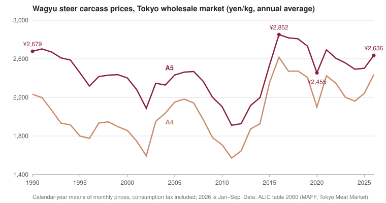

In Tokyo's wholesale market, a kilogram of top-grade wagyu steer carcass sold for an average of ¥2,502 in 2025. In 1990 it sold for ¥2,679. Over the same years Japan turned wagyu into a protected export: beef exports reached a [record ¥73.1 billion in 2025](https://www.maff.go.jp/j/shokusan/export/e_info/attach/pdf/zisseki-308.pdf), and the US was the biggest buyer. Meanwhile most of what Americans buy as "wagyu" comes from a Japanese bull and an American cow. These notes follow the beef from Japanese farms to American plates.

## What counts as wagyu

In Japan, wagyu means four breeds: [Japanese Black, Japanese Brown, Japanese Shorthorn and Japanese Polled](https://www.jetro.go.jp/en/trends/foods/ingredients/wagyu.html), plus crosses among them. Japanese Black dominates. Of the 1.76 million wagyu in Japan in early 2025, [98.4% were Japanese Black](https://www.maff.go.jp/j/chikusan/kikaku/attach/pdf/250428-8.pdf), and the Polled breed was down to about 200 head. Since 2007 the label has also required the animal to be [born and raised in Japan](https://www.maff.go.jp/j/study/wagyu_iden/attach/pdf/wagyu_iden-6.pdf), so foreign beef [cannot be re-imported and sold as wagyu](https://www.jetro.go.jp/en/trends/foods/ingredients/wagyu.html) there.

The famous "A5" is two grades in one. The letter is the [yield grade](https://www.jmga.or.jp/standard/beef/), A through C, for how much meat the carcass gives. The number is the quality grade, 1 through 5. Graders score marbling, meat color, firmness and fat color separately, and the carcass gets the lowest of the four. For marbling, the Beef Marbling Standard (BMS) runs [from No. 1 to No. 12](https://www.jmi.or.jp/en/info/index2.html), and a 5 needs BMS 8 or higher. Japan adopted this measured standard in 1988, [as it opened its market to imported beef](https://www.maff.go.jp/j/chikusan/kikaku/attach/pdf/250428-8.pdf).

Brands such as Kobe sit on top of the grades. Kobe beef must come from Tajima cattle bred and fattened in Hyogo Prefecture, from a heifer or steer, and it needs [a yield grade of A or B, a quality grade of 4 or 5, and BMS 6 or higher](https://www.kobe-niku.jp/en/contents/about/definition.html). It is rare even in Japan, at [less than about 0.2% of the country's beef consumption](https://www.kobe-niku.jp/en/contents/faq/index.html), and it was first exported in 2012, to Macao.

## From draft animal to national asset

For most of their history these were work animals. Tajima cattle were raised [for farm work in the mountains of Hyogo for about 1,200 years](https://pd.jgic.jp/en/register/entry/3.html). There was little demand for beef until the Meiji Restoration in 1868, [for Buddhist and Shinto religious reasons](https://web.archive.org/web/20161127214623/https://ansci.wsu.edu/wp-content/uploads/sites/386/2016/08/BreedingHistoryofJapaneseBeefCattle.pdf). In the early 1900s Japan crossed its native cattle with [Brown Swiss, Simmental, Shorthorn, Devon and others](https://pmc.ncbi.nlm.nih.gov/articles/PMC6039323/), but the crossbreds' price collapsed in 1910 and the boom was over within a decade. Breeders went back to selecting within their own lines, and Japan [recognized three of the breeds in 1944 and Shorthorn in 1957](https://www.jmi.or.jp/en/info/index1.html).

The genetics left Japan in two small waves. Four bulls reached the US in 1975 or 1976 (the [American Wagyu Association's own pages give both years](https://wagyu.org/company/awhf/awhf-historic-museum)). More followed in the 1990s, and by 1998 Japan had sent the US [247 live cattle and 13,000 straws of semen](https://www.maff.go.jp/j/study/wagyu_iden/attach/pdf/wagyu_iden-5.pdf), which were bred up and later exported on to Australia. Then the flow stopped. Japan did not pass a ban. A government panel judged that a legal export ban would be [hard to square with GATT](https://www.maff.go.jp/j/study/wagyu_iden/attach/pdf/wagyu_iden-6.pdf), so the industry restrained itself from 1999, and the 2000 foot-and-mouth outbreak suspended the health certificates exports require.

The law came after a smuggling attempt. In June 2018 someone [tried to export wagyu semen and embryos illegally](https://www.maff.go.jp/j/chikusan/kikaku/kachiku_iden.html). Two laws passed in April 2020 made wagyu genetics a protected asset, with penalties of [up to 10 years in prison or a ¥10 million fine for individuals, and up to ¥300 million for companies](https://www.maff.go.jp/j/chikusan/kikaku/attach/pdf/kachiku_iden-3.pdf).

## Cooking it

Wagyu cooks differently because of its fat. Wagyu fat is high in monounsaturated fat, mostly oleic acid, and it [melts at a low temperature](https://www.jstage.jst.go.jp/article/chikusan/92/1/92_1/_article/-char/en), which a review from Japan's National Livestock Breeding Center links to wagyu's texture and juiciness. In some cuts and animals it [melts below butter](https://www.jstage.jst.go.jp/article/chikusan/92/1/92_1/_pdf). That same review notes wagyu is the exception among beef in working cold, in dishes like sushi, and that so much soft fat is a drawback for high-heat grilling.

Japanese cooking mostly answers with thin slices. In sukiyaki, cooks in Kansai [sear the meat first and then add broth and vegetables](https://www.maff.go.jp/e/policies/market/k_ryouri/search_menu/4477/index.html), while in Kanto, especially at home, the broth goes in first. Japan's beef export council suggests slicing sirloin [about 1.5 mm thick for shabu-shabu](https://jlec-pr.jp/wp-content/uploads/2020/02/beef-Art_of_Japanese_Wagyu_Cooking_Part9.pdf) and swishing it piece by piece through water [at about 80 °C](https://jlec-pr.jp/wp-content/themes/jlec/beef-recipe/en/download/syabusyabu.pdf). It also sears thin sirloin slices with a torch for [aburi nigiri, which it says "rivals fatty tuna"](https://jlec-pr.jp/wp-content/uploads/2020/02/beef-Art_of_Japanese_Wagyu_Cooking_Part10.pdf), and fries 1.5 cm cutlets at 170 °C for [two minutes for gyukatsu](https://jlec-pr.jp/wp-content/themes/jlec/beef-recipe/en/download/katsu.pdf).

A steak needs different handling depending on where it came from. When Serious Eats cooked [Japanese and American wagyu side by side](https://www.seriouseats.com/we-ate-super-expensive-steak-so-you-dont-have-to), the Japanese steaks were cut about half an inch thick, and a cast-iron sear was enough: "once you have your sear, the steaks are done internally as well." They were best at about medium, because the fat needs some heat to melt, while the American steaks peaked at medium-rare and ate "much more like standard steaks." On the plancha, the Japanese beef caused severe flare-ups. The portions differ even more. Serious Eats suggests one to two ounces of A5 per person, so a 13-ounce steak feeds six to twelve, while a 16-ounce American wagyu steak feeds one or two. If you are grinding wagyu for burgers, USDA's safe minimum for ground beef is [160 °F, against 145 °F for steaks](https://www.fsis.usda.gov/food-safety/safe-food-handling-and-preparation/food-safety-basics/safe-temperature-chart).

## Prices

{fig-alt="Line chart of annual average wagyu steer carcass prices in Tokyo, 1990 to 2026. A5 starts at 2,679 yen per kg in 1990, dips to about 1,900 in 2011, peaks at 2,852 in 2016, falls to 2,455 in 2020 and is 2,636 for January to September 2026. A4 follows the same shape about 300 yen lower."}

Japanese carcass prices have gone sideways for 35 years. The chart averages the [monthly Tokyo wholesale prices](https://lin.alic.go.jp/alic/statis/dome/data2/OldDate/2060aD.xlsx) for wagyu steers. A5 dipped in 2002 and again in 2011, peaked in 2016 and fell hard in the pandemic: in April 2020 it averaged ¥2,027 a kilogram, down from ¥2,805 in January 2019. It recovered by the end of that year. This year it has been rising again, and the preliminary September figure was ¥2,709, up 13% from a year earlier. Cows and heifers fetch more than steers: female A5 averaged ¥2,690 in the year to March 2026, against ¥2,509 for steers.

Farmers have been squeezed from both sides. Compound feed rose from [¥61,065 a ton in January 2020 to about ¥88,700 in the year to March 2023](https://lin.alic.go.jp/alic/statis/dome/data2/j_excel/7022a.xlsx), and it was ¥93,925 in July 2026. Calf prices have swung even more. A Japanese Black calf [averaged ¥745,000 at auction](https://lin.alic.go.jp/alic/statis/dome/data2/j_excel/2140a.xlsx) in the year to March 2022, fell to ¥545,000 two years later, and has stayed around ¥840,000 since March 2026. The herd is shrinking too: on February 1, 2026, Japan had [31,800 beef-cattle farms, 6.5% fewer than a year earlier, and 2.47 million head, 4.7% fewer](https://www.maff.go.jp/j/tokei/kouhyou/tikusan/pdf/tikusan_26.pdf).

Exports are where the growth is. Japan's beef exports went from ¥29.7 billion in 2019 to [¥73.1 billion in 2025](https://www.maff.go.jp/j/shokusan/export/e_info/attach/pdf/zisseki-308.pdf), on 12,628 tons, though MAFF counts processed products from 2022 on, so the early years aren't directly comparable. The US took ¥15.4 billion of it, ahead of Taiwan and Hong Kong. Japan's food exports to the US grew 13.7% that year even though new US tariffs started in April, which MAFF puts down to [strong demand for green tea and beef](https://www.maff.go.jp/j/shokusan/export/e_info/attach/pdf/zisseki-280.pdf). Exporters it interviewed also credited tourists who had tried Japanese food in Japan. The government's target is [¥113.2 billion by 2030](https://www.maff.go.jp/j/shokusan/export/progress/attach/pdf/index-43.pdf).

On the US side, the tariff picture has changed twice. Japan used to have its own US beef quota of 200 tons a year. The 2019 trade agreement [eliminated it and gave Japan access to a shared quota](https://ustr.gov/sites/default/files/files/agreements/japan/Letter_Exchange_on_Beef.pdf), which now stands at [52,005 tons at 4.4 cents a kilogram, with 26.4% above it](https://hts.usitc.gov/reststop/file?release=currentRelease&filename=Chapter%202). In November 2025 the White House [exempted beef from the reciprocal tariffs](https://www.whitehouse.gov/presidential-actions/2025/11/modifying-the-scope-of-the-reciprocal-tariff-with-respect-to-certain-agricultural-products/), and in February 2026 the Supreme Court held that the emergency-powers law behind those tariffs [does not authorize the President to impose tariffs](https://www.supremecourt.gov/opinions/25pdf/607us2r12_8nj9.pdf). Beef is getting dearer in the US anyway: USDA forecasts [beef and veal prices up 8.7% in 2026](https://www.ers.usda.gov/data-products/food-price-outlook/summary-findings).

## The American wagyu supply chain

American wagyu starts from a small gene pool. Everything traces back to the few hundred animals Japan sent before 1998. A Washington State University study of 4,132 fullblood pedigrees found an [effective population size of about 17](https://pubmed.ncbi.nlm.nih.gov/24373025/) between 1994 and 2011, and early breeders [ran into problems with inbreeding](https://s3.us-east-1.amazonaws.com/assets.wagyu.org/Wagyu-History-in-the-United-States.pdf).

So most American wagyu is a cross. The American Wagyu Association registers [Fullblood, Purebred (at least 93.75% wagyu) and Percentage animals](https://s3.us-east-1.amazonaws.com/assets.wagyu.org/AWA-Rulebook-Revised-07-21-2026.pdf), but the beef in stores mostly comes from a wagyu bull and an Angus cow. Snake River Farms, which calls itself the largest producer, describes American wagyu as ["a hybrid cross of pure Japanese Wagyu and premium American cattle"](https://www.snakeriverfarms.com/about-us). Crossing makes [large numbers of wagyu-content animals in a single generation](https://www.wagyu.org.au/for-members/fullblood-and-commercial-breeding). The trade-off shows up in feeding trials: wagyu-sired cattle [gained weight more slowly and marbled more](https://pubmed.ncbi.nlm.nih.gov/36592748/) than Angus-sired cattle.

That slow growth is what makes the chain different. A commodity calf spends [90 to 300 days in a feedlot](https://www.ers.usda.gov/topics/animal-products/cattle-beef/sector-at-a-glance). Agri Beef, which owns Snake River Farms, says its wagyu cattle are on feed [about three times longer](https://www.agribeef.com/exceptional-beef/snake-river-farms/) than commodity cattle. It feeds them in Idaho and Washington and processes them at its [Washington Beef plant in Toppenish](https://www.agribeef.com/real-families/processing-wa-beef/). Fullblood producers go further: Lone Mountain Wagyu says its cattle are [never crossbred](https://lonemountainwagyu.com/pages/about-us). Every extra month on feed is feed, pen space and risk that the price has to cover.

The label is loose. USDA's grades stop at Prime, which needs ["slightly abundant" marbling](https://www.ams.usda.gov/grades-standards/carcass-beef-grades-and-standards), and wagyu [often exceeds it](https://wagyu.org/for-consumers/why-should-you-eat-wagyu). For a "Wagyu" breed claim, USDA's labeling guideline asks for documentation tracing the animal to [one registered parent or two registered grandparents](https://www.fsis.usda.gov/sites/default/files/media_file/2021-02/RaisingClaims.pdf), and it sets no minimum wagyu percentage. The industry's answer is certification. A January 2025 USDA specification for an [Authentic Wagyu Beef Program](https://www.ams.usda.gov/sites/default/files/media/G162AuthenticWagyuBeefProgram.pdf) requires Prime with at least "moderately abundant" marbling, and the American Wagyu Association's version adds [DNA parent verification and random DNA checks of meat](https://s3.us-east-1.amazonaws.com/assets.wagyu.org/Manual-RQMT-001-002.pdf). Packers are signing on: Real Kansas Meats became a [licensed Authentic Wagyu partner](https://s3.us-east-1.amazonaws.com/assets.wagyu.org/Real-Kansas-Meats-will-be-a-licensed-Packer-Partner-for-the-Authentic-Wagyu-Certified-Beef-Program.pdf) in May 2026.

## What this means when you buy it

"Wagyu" names two different products. Japanese wagyu is defined by breed, birthplace and a grading system that tells you the yield and marbling in two characters, and Japan has spent decades keeping its genetics at home. American wagyu is mostly a cross, fed for a long time, sold under a label that USDA doesn't tie to a percentage. If you want to know what you're getting, look for the grade and BMS on Japanese beef, and for the breed percentage or an Authentic Wagyu certification on American beef. Then cook the Japanese steak thin and serve it in small pieces, and treat the American one like a very good steak.
