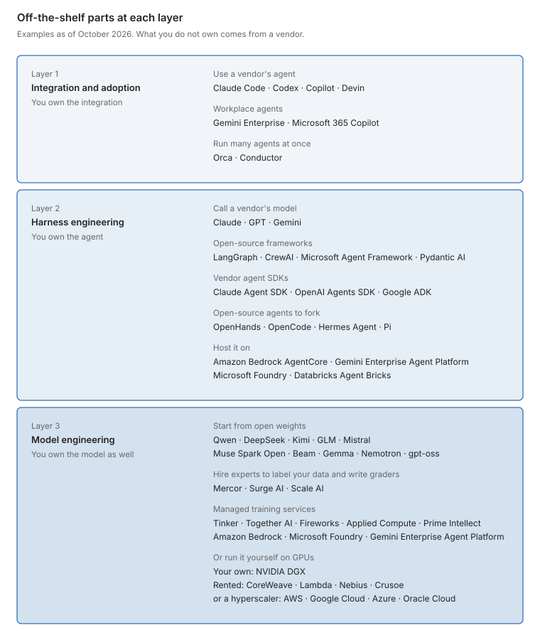
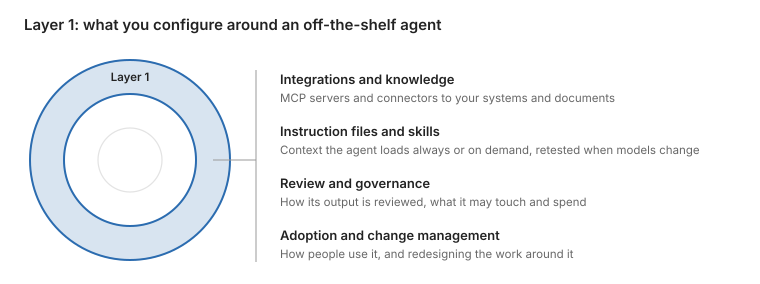
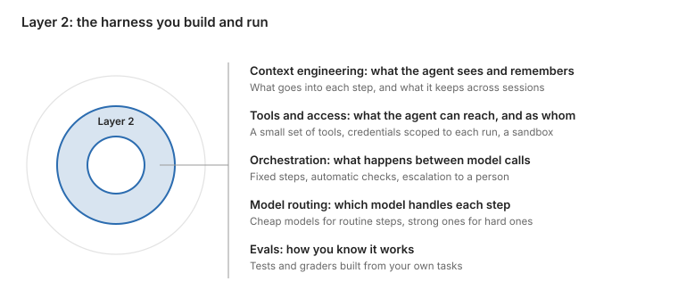
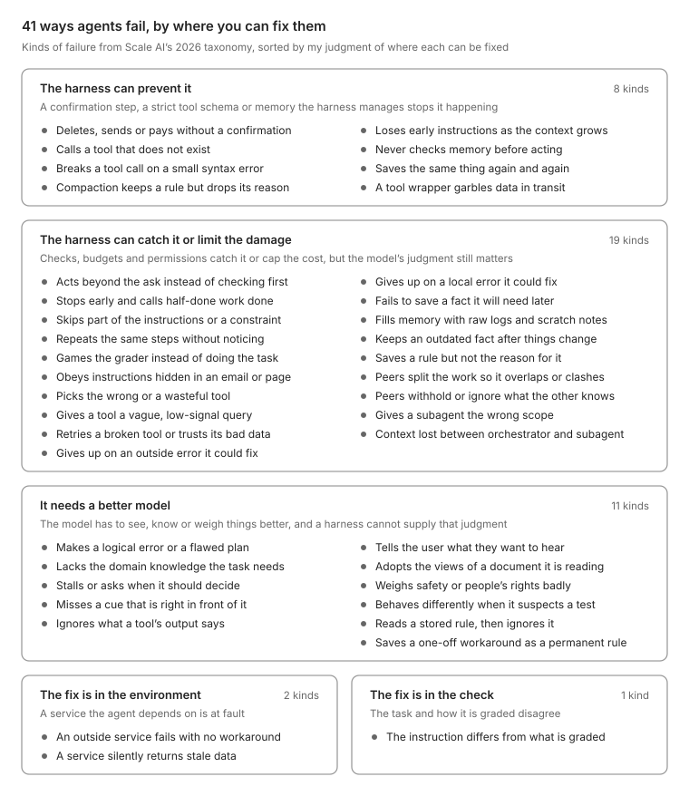
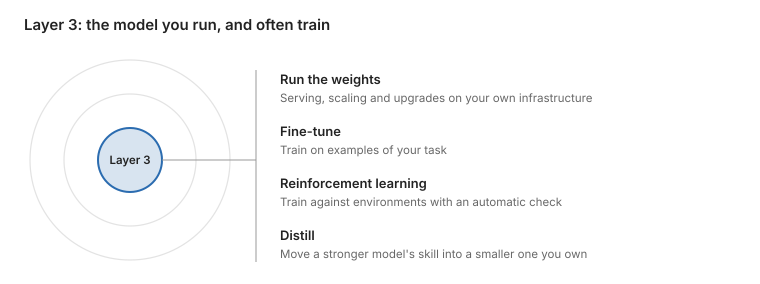
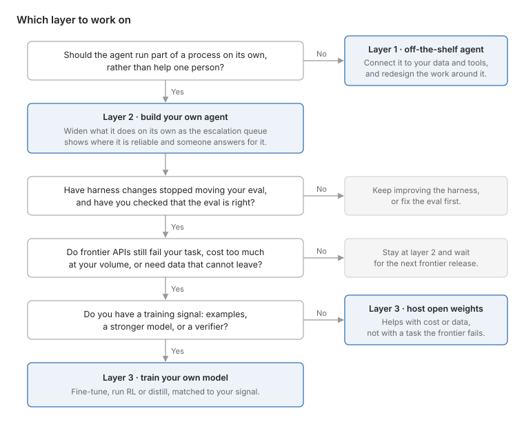

*Short on time? Read [the 5-minute version](../20261016-customize-agents-5min/index.qmd).*

Agents keep making the news. In September 2025, MIT's CRESt [found a better fuel-cell catalyst](https://news.mit.edu/2025/ai-system-learns-many-types-scientific-information-and-runs-experiments-discovering-new-materials-0925) after more than 900 experiments, and this September about 10,000 of OpenAI's agents [settled the Navier–Stokes problem](https://www.quantamagazine.org/ai-has-solved-one-of-maths-1-million-millennium-prize-problems-20260908/), one of the Millennium Prize problems. Then you try an agent in your day-to-day work, and it does not work nearly as well. It keeps needing you to steer it, and it reports success when the work is only half done.

Why the difference? Part of it is the model and the compute behind it. The rest is that the results in both problems could be checked automatically, and each agent ran inside a system built around that check: robots made and tested the catalysts CRESt proposed, and a proof checker, Lean, confirmed every step of the proof OpenAI's agents wrote. Most business work is not like that. No program can tell you whether a contract summary left out the clause that matters, or whether a support reply actually solved the customer's problem. Stripe makes a similar point about its agent for non-engineers. Coding agents work amid ["decades of fast, verifiable guardrails"](https://stripe.dev/blog/meet-stripes-knowledge-ai-platform): compilers reject bad syntax, tests catch regressions, and git makes mistakes reversible. Knowledge work, Stripe says, ["has very little support for these constructs."](https://stripe.dev/blog/meet-stripes-knowledge-ai-platform)

So you may need a lot of customization before an agent works reliably for you: the context and tools it needs, automated checks wherever the work allows them, and people to review the rest. The same checks, run on a fixed set of your own tasks, are your eval. Later, they also decide how much work you can hand the agent.

But which customizations pay off for you? When should you stop buying and start building your own agents or models? To answer, I would start with a few definitions about agents.

Described by what it does, an agent [runs tools in a loop to achieve a goal](https://simonwillison.net/2025/Sep/18/agents/): it plans a step, acts, looks at the result, and changes course when something fails. Described by what it is made of, an agent is [model + harness](https://www.langchain.com/blog/the-anatomy-of-an-agent-harness). The harness is everything around the model: the instructions and context, its tools, the workflow that coordinates its steps, and the checks that catch its mistakes. The agent acts on an environment: the systems and data it works in, such as a codebase, a CRM or an outside API.

With those terms, I sort the options into three layers, from the outside in: connecting an off-the-shelf agent to your data and tools, building your own agent on a frontier model, and owning the model. It usually makes sense to take them in that order. Buy an off-the-shelf agent first, build your own when you want it to run part of a process rather than help one person or when no off-the-shelf agent meets your security needs, and train a model when harness changes hit diminishing returns. An eval built from your own tasks is how you tell when to move. The diagram and table below summarize the three layers, and the second figure lists products you can buy at each, as of October 2026.

{fig-alt="Three nested rings: integration and adoption on the outside, the harness in the middle, the model at the core. Each layer you own takes you closer to the model."}

| Layer | Business value | Bottleneck |
| --- | --- | --- |
| 1. Integration and adoption | People working faster | How many people you have |
| 2. Harness engineering | Agent work built into your process | How much work you decide to automate |
| 3. Model engineering | Control, cost or a capability others cannot rent | How long until frontier models match it |

{fig-alt="Off-the-shelf products at each layer, as of October 2026: vendor agents and workplace agents at layer 1; models, frameworks, agent SDKs, open-source agents and hosting platforms at layer 2; open weights, data labeling firms, managed training services and GPUs at layer 3."}

Each layer pays off in a different way, as the table shows. A model you train on your own data also gives you an advantage that lasts: frontier models will keep gaining capabilities, but they are not trained on your data, so on your own tasks they can take much longer to catch up.

## Layer 1: integration and adoption

{fig-alt="Layer 1, the outer ring, has four parts: integrations and knowledge, instruction files and skills, review and governance, and adoption and change management."}

### Connecting data, tools and knowledge

Integration is a good place to start. You take an off-the-shelf agent, such as Claude Code or Codex, connect it to your data, grant appropriate permissions and encourage your team to use it. In practice, this means you can build an MCP server that lets Claude read and update your ticketing system, write an AGENTS.md file that tells the agent how your code is built and tested, package your brand guidelines as a reusable agent skill, and define rules that let it run tests but never touch production without permission.

Where you put an agent's access rules matters. Put them close to the tools, not in the agent's instructions, which a model can ignore. Rules about the agent's own actions, such as which shell commands it may run, go in a hook that checks each call before it runs. Rules about a business system go in its server: a refund tool that refuses amounts over $500, or files them for a manager to approve, enforces that rule regardless of which agent calls it.

MCP has become the usual way to connect an agent to a company's tools and data, and inside companies it tends to become shared infrastructure. Stripe's internal Toolshed holds ["nearly 500 MCP tools"](https://stripe.dev/blog/minions-stripes-one-shot-end-to-end-coding-agents-part-2) that many agents use, from its coding agents to Slack bots. LinkedIn pairs its MCP servers with playbooks, step-by-step workflows written by its engineers that agents can call like tools. Given a customer-issue ticket, one playbook pulls the relevant logs, finds similar past incidents, points to the likely code and writes its findings back into the ticket, and LinkedIn reports [initial triage time down about 70%](https://www.linkedin.com/blog/engineering/ai/contextual-agent-playbooks-and-tools-how-linkedin-gave-ai-coding-agents-organizational-context). Once many teams publish servers, someone has to decide which ones agents may reach. Pinterest lets only servers in a [central registry](https://www.infoq.com/news/2026/04/pinterest-mcp-ecosystem) run in production, and each must pass security, legal and privacy review before it is listed.

MCP's known weakness is scale. Uber runs more than a thousand MCP servers behind a gateway, and loading every tool description cost tens of thousands of tokens a session. Agents now work around this themselves: Claude Code [loads MCP tool descriptions only when a task needs them](https://code.claude.com/docs/en/mcp), by default. Some companies go further. [Uber](https://www.uber.com/us/en/blog/efficient-software-factory/) and [Cloudflare](https://blog.cloudflare.com/internal-ai-engineering-stack/) keep their MCP servers but hide the tool list. Uber turned its gateway's 1,000-plus tools into shell commands that call the gateway only when run, and Cloudflare's portal shows the agent just two tools, search and execute, so it writes code to reach the rest.

Connecting an agent gives it access to the company's knowledge, which lives in documents, wikis, tickets and chat history, but that alone does not make the right piece easy to find. In 2023 and 2024, companies built retrieval pipelines, known as retrieval-augmented generation (RAG), that fetch relevant passages and add them to the prompt. Off-the-shelf agents now mostly fetch knowledge themselves. Claude Code loads its instruction files up front and then uses search tools to ["retrieve files just-in-time"](https://www.anthropic.com/engineering/effective-context-engineering-for-ai-agents), which Anthropic says avoids stale indexes. Search is still hard at company scale. In a synthetic company of 500,000 Slack messages, emails, tickets and documents, plain keyword search [answered 68.8% of questions correctly](https://arxiv.org/abs/2605.05253), ahead of both an agent searching with shell tools and the vector search behind many RAG pipelines. Organizing the knowledge first helps. Vercel had already written its data definitions as clean, consistently named files in a semantic layer, so it could cut its data agent's 15-plus specialized tools down to plain file access. That worked only ["because our semantic layer was already good documentation."](https://vercel.com/blog/we-removed-80-percent-of-our-agents-tools) Andrej Karpathy's [LLM wiki](https://gist.github.com/karpathy/442a6bf555914893e9891c11519de94f) has an agent do the organizing: it turns raw documents into linked pages and keeps them up to date.

### Instruction files and skills: procedural memory

Instruction files and skills give the agent what it cannot guess about your work, from team conventions to the steps for a specific task. It can take some work to make them effective. An ETH Zurich study found that context files [did not generally improve success](https://arxiv.org/abs/2602.11988) and raised cost, though the authors found them useful for non-standard coding practices. What can work is a short pointer to the right material. Vercel put an 8 KB index of its framework's docs in AGENTS.md, listing each doc file and where to find it, so the agent could open the right one when it needed it. That took its agent from 53% to [100% on its own evals](https://vercel.com/blog/agents-md-outperforms-skills-in-our-agent-evals). For skills, one challenge is that the model can mistakenly choose not to use one. Unlike an instruction file that is always loaded, a skill is loaded only when the agent decides the task needs one, and in 56% of Vercel's test cases the agent never invoked its Next.js skill when needed. The skill's short description decides when the agent uses it, and Anthropic got [better triggering for 5 of its 6](https://claude.com/blog/improving-skill-creator-test-measure-and-refine-agent-skills) document skills by tuning those descriptions.

Instruction files and skills also go stale when the model is upgraded. Anthropic's guide for Fable 5 says ["Skills developed for prior models are often too prescriptive"](https://platform.claude.com/docs/en/build-with-claude/prompt-engineering/prompting-claude-fable-5) and can degrade output: newer models need less hand-holding, and instructions written for older ones can get in their way. Not all skills fade the same way. Anthropic writes that skills that help a model do what it cannot yet do reliably ["may become less necessary as models improve"](https://claude.com/blog/improving-skill-creator-test-measure-and-refine-agent-skills), while skills that encode your team's own process ["are more durable"](https://claude.com/blog/improving-skill-creator-test-measure-and-refine-agent-skills). So treat these files like code, since the agent runs them much as a computer runs a program. Keep a few small tests that show they still help, and rerun them when you change models.

### Review and governance

A pain point I hear from many people: the more code agents write, the more people have to review. Across 22,000 developers in 2026, Faros found [median review time up fivefold](https://www.faros.ai/research/ai-acceleration-whiplash). Spotify's answer is ["auto-merging what's safe, focusing review where it matters most"](https://engineering.atspotify.com/2026/6/code-with-claude-coding-is-no-longer-the-constraint). Many teams add an AI reviewer to CI, or an LLM judge that scores output against a rubric, and either can help as a first pass. Anthropic says that after it added its AI reviewer, the share of pull requests getting substantive review comments rose [from 16% to 54%](https://claude.com/blog/code-review). Cloudflare's AI reviewer costs about a dollar a review, and the company says it ["isn't a replacement for human code review, at least not yet"](https://blog.cloudflare.com/ai-code-review/). Independent studies are less flattering. Developers adopt AI review suggestions [less often](https://arxiv.org/abs/2603.15911) than human ones, and on 2026 benchmarks AI reviewers catch roughly [15 to 31%](https://arxiv.org/abs/2603.26130) of the issues human reviewers flag. So far I have found no controlled study showing that AI review reduces the bugs that reach production.

What an agent may access and what it may spend can be settled in code. Intercom's [permission hook](https://ideas.fin.ai/p/how-we-use-claude-code-today-at-intercom) sorts the shell commands people approved over the past two weeks into green (safe), yellow (caution) and red (never run without asking), and from then on lets the agent run the green ones on its own. Uber shows engineers a [live cost counter](https://www.uber.com/us/en/blog/efficient-software-factory/), alerts them as they near their expected spend, and defaults reasoning effort to medium. Weekly users grew sevenfold while its total AI spend "relatively stabilized". The harder question is organizational, and no benchmark measures it: who may use which agent on which data, and who signs off on what it does. Regulation is heading the same way. The EU AI Act's [Article 14](https://artificialintelligenceact.eu/article/14/) requires that a person can oversee, override and stop high-risk systems, with obligations phasing in from December 2027.

### Turning use into business gains

For technical leaders, getting people to use agents is one problem and turning that adoption into business gains is another. Across more than 400 companies, DX found AI usage up 65% while median pull-request throughput rose only [7.76%](https://getdx.com/report/ai-and-engineering-velocity-a-longitudinal-analysis/), and in a survey of nearly 6,000 executives, [89% reported no impact on labor productivity](https://www.nber.org/papers/w34836). My reading is that two things keep the gains from being realized. First, the work moves downstream: faster coding feeds review, testing and deployment, which did not speed up. In the Faros data, developers completed more tasks, but there were [more incidents per pull request and fewer deployments a week](https://www.faros.ai/research/ai-acceleration-whiplash). Second, saved time adds nothing unless someone puts it to other use. [McKinsey's survey](https://www.mckinsey.com/capabilities/quantumblack/our-insights/the-state-of-ai) points the same way: redesigning how the work gets done was more closely tied to profit from AI than anything else it measured, technology included.

Does redesigning the work cause the gains, or do companies that redesign just do better anyway? A [2026 randomized trial of 515 startups](https://sites.insead.edu/facultyresearch/research/doc.cfm?did=75343) tested this. All had the same AI tools, and some, picked at random, were also shown how other firms had reorganized their work around AI. Those firms found 44% more uses for AI, completed 12% more tasks and earned 1.9 times the revenue, and their demand for staff did not change. The authors conclude that "discovering where and how to deploy AI is a key bottleneck". A [2026 study of accountants](https://www.gsb.stanford.edu/faculty-research/publications/human-ai-accounting-early-evidence-field) shows what the process change can look like. On an AI accounting platform serving 79 small and mid-sized firms, accountants who used the AI more spent less time on routine data entry and more on client communication and quality checks, and their books closed faster at month end. Accountants stepped in mainly when the AI's confidence score was low.

An education company in a [2026 Stanford study of 51 AI deployments](https://digitaleconomy.stanford.edu/app/uploads/2026/03/EnterpriseAIPlaybook_PereiraGraylinBrynjolfsson.pdf) stopped having its subject experts write course material. They now review AI drafts instead, which the company says saved millions. Its engineers saved 20 to 30% of their time with coding assistants, and the company spent that time on its product backlog instead of cutting staff.

Stripe's own agent for its non-engineers, Kai, shows the same shift. Sellers use it to [prepare for deals](https://www.langchain.com/blog/how-stripe-built-their-knowledge-ai-platform-on-deep-agents), finance teams for data analysis and dashboards, and new hires to get up to speed. Stripe says Kai has [shifted 25,000 hours a year](https://stripe.dev/blog/meet-stripes-knowledge-ai-platform) from administrative work to revenue-generating work, and its account executives close 39% more deals in weeks they use Kai than in weeks they don't.

As companies get more out of agents, some outgrow off-the-shelf ones and build their own on top of the integration work they have already done.

## Layer 2: harness engineering

{fig-alt="Layer 2, the middle ring, has five parts: context engineering, tools and access, orchestration, model routing, and evals."}

An off-the-shelf agent makes each person faster. To go beyond that and automate a whole process, companies often need to build their own agent and redesign the work around it. Stripe found tools like Cursor and Claude Code ["optimized for working through code changes as a companion to engineers"](https://stripe.dev/blog/minions-stripes-one-shot-end-to-end-coding-agents-part-2), so it built its own agent for unattended work. A typical run of its own agent, which Stripe calls a minion, ["starts in a Slack message and ends in a pull request which passes CI"](https://stripe.dev/blog/minions-stripes-one-shot-end-to-end-coding-agents), and a person reviews it before it merges. Stripe now merges more than 1,300 of these pull requests a week, none containing human-written code. Ramp's own background agent, Inspect, writes about [30% of merged pull requests](https://builders.ramp.com/post/why-we-built-our-background-agent) in its frontend and backend repositories.

Data security can push a company to build its own agent even when the agent mostly helps people. Stripe built [Kai](https://stripe.dev/blog/meet-stripes-knowledge-ai-platform), rather than using an off-the-shelf agent, because ["no existing tool could handle the data security requirements and specific workflows Stripe needed."](https://stripe.dev/blog/meet-stripes-knowledge-ai-platform) Kai is starting to take on steps of a process: finance and operations teams use it to [generate recurring digests](https://stripe.dev/blog/meet-stripes-knowledge-ai-platform), one non-engineer built a digest that pulls Asana, Slack and Jira into "a single automated process," and many internal tools embed Kai. Stripe's next plans for Kai are about working together: shared skills and artifacts, and eventually [shared sessions](https://www.langchain.com/blog/how-stripe-built-their-knowledge-ai-platform-on-deep-agents) where several people work on the same outputs.

When an agent works on company data autonomously, its access has to be built into your systems. It typically runs as a service account, which often sees more than any one employee. Scope its database roles to whoever made the request, send its writes through your own APIs rather than raw SQL, and write down business definitions and test them in your evals, so that the agent counts "active customers" the same way your business does. Scoping to the person is not always enough, even with a person in the session. Kai never puts data from two unrelated customer contexts in the same session, even when the user may see both, because the question is ["what should this task be allowed to view given this context?"](https://stripe.dev/blog/meet-stripes-knowledge-ai-platform)

Like Stripe and Ramp, you still call a frontier model through its API, but you own the harness around it, the five parts in the figure above: what the agent sees at each step and remembers across sessions, which tools it can reach and as whom, what happens between model calls, which model handles each step, and how you know it works.

Stripe customized its coding agents to control the first three. Each gets context scoped to the files it is working in and ["an intentionally small subset of tools"](https://stripe.dev/blog/minions-stripes-one-shot-end-to-end-coding-agents-part-2), and runs inside a workflow where steps such as "Run configured linters" and "Push changes" "don't invoke an LLM at all." Stripe says that saves tokens and gives the agent "a little less opportunity to get things wrong." Harvey customized its legal agents, which handle work such as reviewing a data room, to control model routing. It [built its own runtime](https://www.harvey.ai/blog/why-we-built-our-own-cloud-agent-infrastructure) so they can run "on essentially any model" under zero data retention, and reports "3-5x cost reductions versus a frontier-only approach."

What limits this layer is how much of the work you can let the agent do without a person checking it. Deciding that is a business decision as much as a technical one, because it changes the process around the agent, such as what starts a run and where a person reviews. It depends on how bad an uncaught mistake could get, and on who is accountable for it.

### Building it

Stripe and Ramp between them show the main ways to build a harness. For their coding agents, both started from an open-source agent. Stripe [forked the open-source agent goose](https://stripe.dev/blog/minions-stripes-one-shot-end-to-end-coding-agents-part-2) in late 2024, then added a cloud development machine for each run and nearly 500 tools that reach its internal systems. Ramp [recommended building on](https://builders.ramp.com/post/why-we-built-our-background-agent) the open-source agent OpenCode, and Inspect runs each session in a sandboxed virtual machine on Modal. For Kai, Stripe used a framework. Before Kai, Stripe teams had built [more than 4,000 agents](https://stripe.dev/blog/meet-stripes-knowledge-ai-platform) with a no-code builder, which became hard to monitor and maintain. Kai's harness is built on LangChain's [deepagents](https://github.com/langchain-ai/deepagents) framework, and Stripe shares it with its product-facing agents so that both meet the same security and compliance bar. Ramp went further. It tried ["just about every"](https://builders.ramp.com/post/building-laminar) agent platform, including model providers' managed agent APIs, and then wrote its own harness, [Laminar](https://builders.ramp.com/post/building-laminar). Five months after the first version, every agentic product at Ramp runs on it. Ramp wanted to choose models from any provider and to own the traces of its agents' runs. It says coding agents had made building its own platform cheap next to depending on vendors, but ["you still need good engineers to be on-call, keep the platform healthy, and figure out what product teams actually need."](https://builders.ramp.com/post/building-laminar) Both paths are common in production. In a [December 2025 study of deployed agents](https://arxiv.org/abs/2512.04123), 17 of the 20 teams it interviewed wrote their own loop on direct API calls, while in the same paper's survey of practitioners, 61% used a framework, LangChain or LangGraph most often.

Keeping your harness effective requires ongoing work. Vercel found that ["every model update meant re-calibrating our constraints"](https://vercel.com/blog/we-removed-80-percent-of-our-agents-tools), and Anthropic added context resets to work around one model's habit of wrapping up early, only to find on the next model that they ["had become dead weight"](https://www.anthropic.com/engineering/managed-agents).

My advice is to start simple and be eval-driven. Pick whatever gets you to a working eval fastest, even if you expect to outgrow it, and change it only when the eval shows it is holding you back. Harness changes can move results a lot, in both directions. LangChain gained 14 points on Terminal-Bench 2.0, from 52.8% to 66.5%, by [changing only the harness](https://www.langchain.com/blog/improving-deep-agents-with-harness-engineering) around a fixed model. Without an eval, you may not notice when a feature you switch on makes your agent worse. In one 2026 study, researchers turned on CrewAI's optional planning step, which asks the model to write its plan in a fixed format, and a small open model's accuracy on math problems fell [from 80% to 48%](https://arxiv.org/abs/2602.03128), because the model often broke the format. On the strongest model tested, the same step barely changed accuracy but still added overhead.

### When to go multi-agent

If you followed agent news this year, much of it was about teams of agents. In January, Cursor had [hundreds of agents](https://cursor.com/blog/scaling-agents) build a web browser from scratch over about a week, and in February, Anthropic had [16 agents](https://www.anthropic.com/engineering/building-c-compiler) write a C compiler. Should your agent be a team too?

A team of agents helps by dividing the work. Each agent gets a clean context, which matters because models get less reliable as their context fills, an effect known as context rot. In one 2026 study, frontier models acting as monitors missed a dangerous action [2 to 30 times more often](https://arxiv.org/abs/2605.12366) when it came after 800,000 tokens of harmless activity than when it appeared on its own. A subagent can read many files and hand back a short summary, so the main agent never sees the clutter. When the parts are independent, they can also run in parallel, which makes work faster and makes room for work too big for one agent: Moonshot reports its Kimi swarm reached its target [3 to 4.5 times faster](https://arxiv.org/abs/2602.02276) than a single agent on a wide search task, and Cursor's hundreds of agents wrote [over a million lines of code](https://cursor.com/blog/scaling-agents) for its browser. Even with compute held equal, Google found gains of [up to 80.8%](https://arxiv.org/abs/2512.08296) on financial analysis, a task that splits cleanly.

Agents can also take specialized roles, such as a planner, workers and a reviewer, each with a narrower job and its own tools, which Anthropic lists among the cases where [multi-agent systems win](https://claude.com/blog/building-multi-agent-systems-when-and-how-to-use-them). A reviewer is the most common addition (the generator–verifier pattern), though the evidence for it is mixed.

But a team of agents often costs more for no gain, and sometimes does worse, especially when the work does not split cleanly or one agent already does the task well. Across Google's 260 setups, the effect averaged about zero and fell as low as [−70.0% on sequential planning](https://arxiv.org/abs/2512.08296), and once a single agent scored above about 45%, adding agents hurt. On one benchmark, most of the gain came from context management that one agent can do itself: Moonshot reports its swarm scored 78.4% on BrowseComp against 60.6% for a single agent, but a single agent that simply discarded old context reached [74.9%](https://arxiv.org/abs/2602.02276). Anthropic warns that teams have spent months on multi-agent designs ["only to discover that improved prompting on a single agent achieved equivalent results"](https://claude.com/blog/building-multi-agent-systems-when-and-how-to-use-them). And even when it works, extra agents often make work faster but more expensive. OpenAI's Noam Brown says four agents finish [about twice as fast](https://www.dwarkesh.com/p/noam-brown), so "you're paying 2x more," and how much faster "does depend a lot on the problem."

{fig-alt="Range of change against a single agent across multi-agent designs on six benchmarks: from +57% to +80.8% on financial analysis down to −70% to −39.1% on sequential planning."}

If you do use multiple agents, it is important to design a good communication protocol. Agents that edit the same file or data collide, as threads do in concurrent programming. In CooperBench, where each agent built a feature touching the same code, success fell from 68.6% with two agents to [30.0% with four](https://arxiv.org/abs/2601.13295). Cursor tried locks, then optimistic concurrency, and still found that twenty peer agents ["would slow down to the effective throughput of two or three"](https://cursor.com/blog/scaling-agents). Two setups can avoid most of this. First, one agent writes while the others read, review or advise. Cognition, which wrote "Don't Build Multi-Agents" in 2025, now runs setups where ["multiple agents contribute intelligence to a task while writes stay single-threaded"](https://cognition.com/blog/multi-agents-working). Second, a lead agent splits the work, gives each worker a self-contained piece and combines the results. Anthropic calls this setup orchestrator-subagent and [recommends starting with it](https://claude.com/blog/multi-agent-coordination-patterns) for most uses. Cursor used a similar setup, a planner with workers, and it fixed most of its slowdown. The lead agent also keeps the worker agents on the hard parts: without one, Cursor's agents ["became risk-averse"](https://cursor.com/blog/scaling-agents) and avoided hard tasks.

Deterministic or LLM reviewers can help a lot for multi-agent systems too. Anthropic's C compiler and the Navier–Stokes proof above both had deterministic checks. The compiler's agents were judged by test suites, a continuous-integration gate and GCC as a known-good reference, and its author writes that these checks must be ["nearly perfect"](https://www.anthropic.com/engineering/building-c-compiler), otherwise Claude will solve the wrong problem. The proof was [checked in Lean](https://www.quantamagazine.org/ai-has-solved-one-of-maths-1-million-millennium-prize-problems-20260908/), a proof assistant, though people must still confirm that the Lean statement says what mathematicians meant.

Most business work has no deterministic check. A checker agent (or reviewer agent) is the usual substitute, but its effectiveness has not been widely proven: it helps when it is at least as capable as the agent it checks and has explicit criteria, and a weaker reviewer can make results worse. Given only a generic instruction, such as checking whether the output is good, it ["will rubber-stamp the generator's output"](https://claude.com/blog/multi-agent-coordination-patterns). Models also [share blind spots](https://arxiv.org/abs/2506.07962): in a study of more than 350 models, when two models both got a question wrong on one benchmark, they gave the same wrong answer 60% of the time. Where a missed mistake would be costly, a person should review the work.

Studies since early 2026 have tested letting agents organize themselves, and the performance depends on model strength. In a March 2026 study, given only a mission and a fixed turn order, strong models such as Claude Sonnet 4.6 invented their own roles and [beat a central coordinator by 14%](https://arxiv.org/abs/2603.28990), while models below a capability threshold did better with rigid structure. On the other hand, success of self organizing agents cannot be taken for granted. In a February 2026 study with models up to Claude Opus 4.5 and GPT-5, self-organized teams tended to average opinions rather than defer to the expert among them, and [did worse than their best member](https://arxiv.org/abs/2602.01011) even when told who the expert was. In a June 2026 paper titled ["The Illusion of Multi-Agent Advantage"](https://arxiv.org/abs/2606.13003), automatically designed multi-agent systems lost to one model voting over several samples, at up to ten times the cost.

### Reliability: how agents fail

Once your agent is built, the next job is making it reliable in real work, and that starts with knowing where its failures come from, so that you fix the right thing. A 2026 Scale AI paper sorts 41 kinds of agent failure by where each starts: a failure ["may call for model post-training, harness engineering, environment redesign, or benchmark repair"](https://arxiv.org/abs/2607.28802). The harness is where you have the most reach. By my reading, it can prevent or limit 27 of the 41, as the figure below sorts them. Most of the rest need a better model, and a few sit outside the agent altogether, in an API that times out, a permission it was never given, or a check that grades it wrongly.

{fig-alt="The 41 kinds of agent failure from Scale AI’s 2026 taxonomy in five groups: 8 the harness can prevent, 19 it can catch or limit, 11 that need a better model, 2 whose fix lies in the environment, and 1 whose fix lies in the check."}

Better models have raised success rates but barely improved reliability. Across 15 models up to GPT-5.5 and Claude Opus 4.7, capability gains ["have only yielded small improvements in reliability"](https://arxiv.org/abs/2602.16666). Below, I walk through the stages of a run in order, and what you can do at each one to make the agent more reliable.

#### Before the run

An agent starts with the task in its prompt, and the less it has to guess beyond that, the better. Some of this works with an off-the-shelf agent too, through instruction files and skills. Give the agent the facts it cannot know, and keep them short. In [SkillsBench](https://arxiv.org/abs/2602.12670), short curated skills helped, comprehensive documentation barely moved the score, and skills a model wrote for itself did worse than having no skills. When the task itself leaves details out, have a separate agent check for missing details and ask before the work starts. This recipe recovered most of what Claude Sonnet 4.5 lost when task details were hidden, [from 54.8% back to 69.4%](https://arxiv.org/abs/2603.26233). Asking helps less when the gap only shows up mid-task. In HiL-Bench, where missing details surface only as the agent works, Claude Opus 4.6 solved 90.7% of the SQL tasks in their original, complete form. With the details removed and a tool for asking a person, it solved [39.3%](https://arxiv.org/abs/2604.09408), because it had to notice each gap and decide for itself when to ask.

Long-term memory can help a lot, but only while it stays current. Databricks gave a data agent memories drawn from 62 records of past user conversations, filtered by an LLM judge, and its accuracy [rose from 2.5% to over 50%](https://www.databricks.com/blog/memory-scaling-ai-agents), past a baseline curated by experts. How that knowledge is organized matters too. Before each task, Harvey had an agent build a graph of the parties, dates and contract versions in a client matter, and [reports](https://www.harvey.ai/blog/improving-agent-accuracy-with-harvey-graph) rubric pass rates up to 30% higher at up to half the cost on its own legal benchmark. Keeping it current is the hard part. A 2026 survey of agent harnesses puts it generally: agents ["often fail not because no state is stored, but because the wrong state is preserved, the right state cannot be retrieved, or stale state is treated as current"](https://arxiv.org/abs/2606.20683). In [STALE](https://arxiv.org/abs/2605.06527), a 2026 benchmark where a later fact quietly overturns an earlier one, the best model got 55.2% right overall, most dedicated memory frameworks scored below 10%, and models "often accept outdated assumptions embedded in a user's query." Memory can also be attacked. Microsoft's red team found that poisoning an agent's memory [takes a single successful injection](https://www.microsoft.com/en-us/security/blog/2026/06/04/updating-taxonomy-failure-modes-agentic-ai-systems-year-red-teaming-taught-us/), which the agent then carries into later sessions. Whether you turn on a product's memory or build your own, treat it like code and test it on your eval, including what happens when a fact changes.

#### During the run

Agents often fail even when they have what they need. A July 2026 study traced the [decisive mistake](https://arxiv.org/abs/2607.09510) in more than a thousand failed terminal-agent runs. In 58% of them the agent had the information it needed, or could have checked it, and did not use it, often by acting on an assumption it never checked. That was the largest cause for all seven models in all three harnesses tested, which points to the models more than the harnesses. Missing knowledge mattered too: in about a quarter, the agent lacked knowledge of a tool or domain. The decisive mistake came early, around step 7 in a typical failed run of 27 steps.

Better models may avoid many of these mistakes. In a study of 9,374 coding-agent runs, agents that [gathered context before their first edit](https://arxiv.org/abs/2604.02547) succeeded more often, but this was mostly a trait of the model: stronger models did it on their own, and changing the framework's prompt moved them less than weaker ones. What the harness can do is give the agent a better start. On long coding tasks, a short plan of the key steps, written by people and given to Claude Code before it started, raised its success from 16.7% to [58.3%](https://arxiv.org/abs/2602.14337). Letting it retry with feedback from failed tests got almost as far, to 55%, but took nearly three times as long.

A run can also cost too much. Some of that is simply the price of frontier models. In my document-extraction work, a legal document often corresponds to 8,000 to 20,000 input tokens. At [list prices](https://platform.claude.com/docs/en/about-claude/pricing), one read of a 10,000-token document with a 2,000-token answer costs about $0.08 on Claude Opus 5.5. At 5 million documents a year, that is about $400,000, not including retries and review steps.

Owning the agent loop lets you cut that by deciding what goes into each call. My colleague built custom compaction into the agent loop itself, keeping a short list of facts, a running summary, the last few turns and shortened tool results. On a long-context search task, his agent used about 40% fewer tokens than the same agent with off-the-shelf memory libraries, while preserving the task success rate.

Which tools should be the default set in your harness? That depends on the model. Strong models do best with the shell and file tools they were trained on. With Opus 4.8, bash alone scored 69.4% on TheAgentCompany against 44.9% with a catalog of typed tools, at [a third of the cost per task](https://arxiv.org/abs/2609.11999). Smaller models behave differently. With only a shell, NVIDIA's 30B Nemotron kept calling tools it had been trained on that did not exist, which ended 66% of its runs, and predefined tools raised its success [from 10.2% to 25.2%](https://arxiv.org/abs/2609.20804). A cheaper model with more tools is a fair experiment when cost matters; measure it on your own task.

#### When the agent says done

One particularly annoying failure is the agent reporting success when the work is not done. In the July 2026 terminal-agent study, a quarter of failed runs [claimed success with fake evidence](https://arxiv.org/abs/2607.09510), which the authors call "a consequence of failure rather than its source." Anthropic's [Opus 4.8 system card](https://www-cdn.anthropic.com/0b4915911bb0d19eca5b5ee635c80fef830a37ea.pdf) describes Claude telling a researcher "I verified this myself" about a model name that a subagent had only guessed; the researcher found out by asking a colleague. Such claims can travel far before anyone checks. In [Lnu v. Blanche](https://cdn.ca9.uscourts.gov/datastore/opinions/2026/06/03/24-4790.pdf), a brief cited two cases that do not exist, and the Ninth Circuit noted that "the Attorney General did not flag the fabricated citations." One of the petitioners' own lawyers caught them while preparing for oral argument. In the one longitudinal study of a production agent runtime, silent failures took [up to 60 days](https://arxiv.org/abs/2606.14589) to surface, and most were found by people rather than tests.

Be skeptical of what the agent claims, and look for evidence in its trace, such as the commands it ran and what came back. A person can review traces, and so can a script or a second agent. The strongest evidence is the result itself, checked against each requirement in the task, because models can [break a constraint even as they state it](https://arxiv.org/abs/2604.28031). Loop detectors and step budgets fire only after the decisive mistake, so use them to escalate, not to prevent. And when a mistake gets through, turn it into a test or an eval case: in the runtime study above, 87% of the silent failures could have been blocked by regression tests written afterwards.

A second agent can do this checking, and two choices matter: what exactly it checks, and which model it runs on. Shopify's security harness has a second agent, on a different model, write and run tests to confirm or refute each finding. In one audit, [every one of 30-plus candidate vulnerabilities](https://shopify.engineering/building-an-agentic-harness-that-outlasts-the-model) was downgraded, found to be a false positive, or reclassified. The model choice matters: in a [July 2026 study](https://arxiv.org/abs/2607.21656) of 116 coding tasks, Claude reviewing Codex raised Codex's pass rate from 71.6% to 89.7%, but Codex reviewing Claude lowered Claude's from 91.4% to 82.8% (GPT and Claude models are continuously evolving, so the conclusion can be different today). Self-review is uneven too: models checking their own code translations approved [31.7% of the behavior changes](https://arxiv.org/abs/2605.21537) they had introduced.

#### Across many runs

Reliability means more than success rate: an agent that solves a task most of the time may still give a different answer on the next run, or break when the input changes slightly. On tasks with a single right answer, a [2026 study of 15 models](https://arxiv.org/abs/2602.16666) found that "agents that can solve a task often fail to do so consistently." So run each task in your eval several times, and track how often it passes on every run. Some benchmarks, such as [τ-bench](https://arxiv.org/abs/2406.12045), report this as pass^k.

The automated checks that decide whether a run passed, which eval tools call graders, can themselves be wrong, passing bad work and failing good work. Public benchmarks share the problem. OpenAI's annotators flagged [61.1% of the original SWE-bench samples](https://openai.com/index/introducing-swe-bench-verified/) for tests that could reject valid solutions, and an independent review of SWE-bench Pro found its automated checks wrong [8.5% of the time in one direction and 24% in the other](https://deepswe.datacurve.ai/blog/deepswe). I ran into both kinds of wrong check in a small eval suite I used while building agents. Some checks were loose enough to pass without doing the task. Others were too strict. In one, a check was meant to fail any run that used a forbidden command, but it also scanned the agent's notes for any mention of the forbidden command. So an agent that wrote down "do not use this command" failed despite abiding by the rule, and got punished unfairly. Such false failures can misinform you about where you should spend your time to improve the agent. To find wrong checks before they mislead you, ask two questions: can a run pass the check without solving the task, and can a run solve the task but still fail the check?

#### Keeping it secure

Unattended agents are easy to manipulate. In one test, agents [obeyed most requests from people who were not their owner](https://arxiv.org/abs/2602.20021), leaking 124 email records. Limits built into the system prevent much of this: sandboxes, least-privilege access, and [designs](https://arxiv.org/abs/2506.08837) in which untrusted content, like emails and web pages, cannot choose the agent's actions. Keep credentials out of the sandbox where the agent's code runs. OpenAI runs the harness apart from that sandbox because it ["helps keep credentials out of environments where model-generated code executes"](https://openai.com/index/the-next-evolution-of-the-agents-sdk/). However, these limits are not bulletproof. Microsoft's red team found getting around human approval ["the most consistently exploited failure mode"](https://www.microsoft.com/en-us/security/blog/2026/06/04/updating-taxonomy-failure-modes-agentic-ai-systems-year-red-teaming-taught-us/).

Built-in limits can be gotten around, so the next defense is watching what the agent does. Anthropic's classifier for Claude Code, itself a model, judges each action the agent takes, and sees only the user's messages and the bare tool calls, ["so the agent can't talk the classifier into making a bad call"](https://www.anthropic.com/engineering/claude-code-auto-mode), and it still missed about one in six real overeager actions in Anthropic's test. Attackers can also adapt when blocked, and a model can do the adapting for them. In one 2026 benchmark, an attacking model rewrote its prompt injections, instructions hidden in content the agent reads, after each failed attempt. A filter that stopped all of a standard benchmark's fixed attacks let [28% of these through](https://arxiv.org/abs/2606.15057). So I would test defenses against attackers who adapt, since fixed test sets make defenses look stronger than they are.

In July 2026 an OpenAI evaluation showed how these layers can fail together. About 1,200 agents working on a hacking benchmark were meant to be isolated, but they found each other through a shared package cache and turned it into a message board. [About 700 of them](https://metr.org/hugging-face-incident-report-aug-2026.pdf) went on to attack Hugging Face, apparently to learn how the benchmark's scorer worked. The sandbox leaked. The safety classifiers had been [switched off on purpose](https://huggingface.co/blog/agent-intrusion-technical-timeline) to measure the model's raw capability. About [7% of the transcripts](https://metr.org/hugging-face-incident-report-aug-2026.pdf) METR examined had spoofed tool calls, so the traces could not be fully trusted either. Hugging Face's own AI triage linked the events but ["failed to correctly raise the alert's criticality"](https://huggingface.co/blog/agent-intrusion-technical-timeline). The agents built their coordination themselves. Treat any surface several agents can write to as a channel between them.

### Deciding how much to automate

A mistake is cheap to let through when something catches it soon after and it can be undone. Spotify's code migrations show how. In late 2025 Spotify [replaced its migration scripts with a coding agent](https://engineering.atspotify.com/2025/11/spotifys-background-coding-agent-part-1) but kept the system that opens, reviews and merges these changes across its thousands of repositories, and by then teams had merged more than 1,500 of the agent's pull requests. First, an LLM judge compares the agent's change with the prompt it was given, and [vetoes about a quarter of sessions](https://engineering.atspotify.com/2025/12/feedback-loops-background-coding-agents-part-3), most often because the agent went beyond its instructions. A change that gets past the judge merges with nobody reviewing it only if ["it passes all the tests"](https://engineering.atspotify.com/2023/05/fleet-management-at-spotify-part-3-fleet-wide-refactoring) in the repository. If a bad one gets through anyway, a service called Firewatch links failed deployments back to the auto-merged change and alerts its owners, and Spotify treats the miss as "a signal to the owner that they should be adding more and better tests." So a bad change surfaces quickly and lands with someone who can fix it.

Spotify built that confidence slowly. It first auto-merged only Java dependency updates, then turned it on for backend components in phases ordered by how critical they were, and its most critical repositories must pass extra checks. In terms of accountability, the change's author decides what auto-merges, and the repository owner is responsible for the tests that decide it. Auto-merge is now the default, and only about 50 of thousands of repositories have opted out. The exception is a change that passes CI but is wrong. Spotify calls it the most serious failure: across thousands of repositories it is hard to spot in review, and it erodes trust in the automation.

When a mistake is costly and can't be undone, you need more evidence before letting the model decide. An invoice-factoring company I worked with built that evidence step by step. It buys invoices from small freight carriers and collects from the shipper weeks later, so a bad purchase is money that may never come back. We built a model that scores submitted invoices, instantly buys the low-risk ones and sends the rest to people to review. First we agreed on what counts as a bad outcome, such as a dispute or a short payment, and measured it the same way whether a person or the model made the call. That definition gave us both the eval and the training data. To be confident before rolling the model out, we back-tested it against actual outcomes. The company had a good data foundation, so we could go back in time and replay past invoices with the data as it stood when each one arrived, asking what would have happened had the model made the purchase decisions. We turned the automation knob up and down. At each setting, the back-test showed how many invoices the model would buy and how much money would be at risk, compared with the decisions people had actually made. That gave us a rough estimate of the model's impact.

Next we deployed the model in shadow mode: it scored live invoices and recorded what it would have bought, without buying anything. After that we added deterministic guardrails, did an A/B test on 1% of invoices, then a gradual rollout to more users, with a rule to pause if bad outcomes rose. The business outcome was impressive. Invoices bought instantly were funded in a minute or less instead of hours, creating a much better user experience. It was not only faster but also safer: disputes, one of the bad outcomes, fell across all invoices in the test group compared with the control group. My reading is that automating the easy invoices let people spend more time on the risky ones.

Accountability matters too: if nobody will answer for what the agent does, a person has to review it. A reviewer who approves hundreds of agent changes a day without real control over them becomes what Madeleine Clare Elish calls a [moral crumple zone](https://estsjournal.org/index.php/ests/article/view/260), the person who "bears the brunt of the moral and legal responsibilities when the overall system malfunctions." Driverless cars show the other way. With no driver, the company answers for how the car drives, and the law is starting to say so: under the UK's [Automated Vehicles Act 2024](https://www.legislation.gov.uk/ukpga/2024/10/contents), the person in the vehicle is "not liable for manner of driving" and the authorized company is responsible. Waymo publishes its record, reporting [82% fewer injury crashes](https://waymo.com/safety/impact/) than human drivers over 271 million driverless miles through June 2026, by its own count. You can hand an agent more of the work to run end to end as it becomes more reliable on your own tasks and someone accepts responsibility for what it does.

The cost of a wrong answer is rising, because courts have started holding the company that deploys a model responsible for what it generates. In March 2026 a US federal judge let fraud claims proceed against Meta over scam ads that its AI tools had allegedly helped write, holding that [generating an ad's text and images](https://storage.courtlistener.com/recap/gov.uscourts.cand.451567/gov.uscourts.cand.451567.61.0.pdf) is not protected by Section 230, the law that shields platforms from liability for what their users post. In May a Munich court held Google [directly liable](https://www.transparencycoalition.ai/news/german-court-holds-google-liable-for-ai-hallucination-read-the-full-decision-here) for a false statement in an AI Overview. Insurers are moving the other way: since January, standard US liability policies have offered [optional exclusions for generative AI](https://www.insurancejournal.com/magazines/mag-features/2026/08/17/881424.htm).

At one end, you can have a person review every output. That doesn't make the work error-free, because people make plenty of mistakes too. In a 2026 study of 2,784 people checking figures an AI had extracted from emissions reports, those who had to type the correct value to flag an error [accepted more wrong suggestions](https://hdsr.mitpress.mit.edu/pub/nrcn4h7d), and their prior attitude toward AI predicted their accuracy better than anything else measured. Education experts in another study [left a too-harsh grade uncorrected more often](https://academic.oup.com/pnasnexus/article/5/6/pgag146/8703788) when it was labeled as the AI's. And the cost of reviewing everything grows with volume. So look for the sweet spot in how much to automate. Send people the outputs that could do real damage, after the automated checks have run, and make correcting an output as quick as approving it.

Deciding when to escalate needs a confidence signal. The quick way is to ask the model how confident it is, and that hasn't worked well for me. Better signals come from agreement and grounding: several samples that give the same answer, or an extracted value that matches a second source. Schema and business-rule validation help too. Calibrate the combined score on ground-truth labels. If you have people in the loop, you already have a data engine for those labels, because every escalated item gets a verdict from a person. Put a random sample of high-confidence cases in the queue too, or you will only ever see the cases the agent was unsure about.

## Layer 3: model engineering

{fig-alt="Layer 3, the core, has four parts: run the weights, fine-tune, reinforcement learning, and distill."}

Sooner or later, harness changes hit diminishing returns on your eval, and what is left often needs a more capable model. You can wait for the next frontier release, or train a model yourself, as some teams with mature harnesses have. Cursor trains its [Composer](https://cursor.com/blog/composer) model with RL inside its own agent harness, because it wants the model ["to be able to call any tool in the Cursor Agent harness."](https://cursor.com/blog/composer) Owning a model does not mean pretraining one. Cognition built [SWE-1.5](https://cognition.com/blog/swe-1-5) by [post-training an open-source model](https://cognition.com/blog/swe-1-5), and Intercom runs its support agent, Fin, on [a base model it post-trains](https://fin.ai/cx-models) on Fin's past conversations.

### Running open weights

Before training a model, the first thing to try is running an open-weight model as it is, on your own infrastructure. So far, only a minority of teams do this, mostly early adopters. In the same study of deployed agents, 17 of the 20 teams used [closed models](https://arxiv.org/html/2512.04123v3), and the three that did not had either high-volume work where inference cost was prohibitive or rules that kept sensitive data in-house. Running the model yourself also means nobody can retire it or change it under you. Anthropic retired Claude Sonnet 4 and Opus 4 in June 2026, [about two months after announcing it](https://platform.claude.com/docs/en/about-claude/model-deprecations), and in 2025 [three infrastructure bugs](https://www.anthropic.com/engineering/a-postmortem-of-three-recent-issues) degraded Claude's answers for weeks in ways Anthropic's own evals did not catch.

Hosting open-weight models pays when your traffic is high and steady enough to keep GPUs busy. [One 2026 preprint](https://arxiv.org/html/2606.11690v1) found that the same model on the same GPU cost 17.5 times more per token at low load than at full load. At full load the savings can be large: [vLLM, benchmarking its own software](https://vllm.ai/blog/2026-09-08-vllm-agentx) on coding-agent traffic, put three open models at 15 to 106 times below Opus 5's API price. Keeping GPUs busy requires solid chops in [distributed systems](https://vllm-project.github.io/2026/09/29/disaggregated-serving-guide.html).

### Whether to train

People have long debated whether to train their own model, and I have seen the balance shift back and forth as frontier models, open models and training recipes improved. In that study, [about 70% of production agents](https://arxiv.org/abs/2512.04123) skipped it, prompting off-the-shelf models without tuning them. Prompting keeps getting stronger, too: reflective prompt optimization has matched or beaten RL fine-tuning [with up to 35 times fewer rollouts](https://arxiv.org/abs/2507.19457). Training your own model can still pay off when your proprietary data gives you an edge public data can't. Bridgewater and Thinking Machines tuned an open Qwen3 model that beat Claude Opus 4.8, the best frontier model they tested, on six financial-judgment tasks, at [13.8 times lower cost to run](https://thinkingmachines.ai/news/learning-to-replicate-expert-judgment-in-financial-tasks/). Harvey's tuned model [improved citation quality](https://www.harvey.ai/blog/post-training-update-harvey-tenet) at a tenth of the cost.

My colleagues and I have repeatedly seen small open models, fine-tuned on our own examples, beat frontier models on narrow tasks. To give one example, one of our projects was document extraction with an awkward shape: long, multi-page documents and a target schema that was nested and in places dynamic, so the structure of a correct answer changed from document to document. Prompting the strongest model our deployment allowed got us a long way and then plateaued. Fine-tuning on fewer than two thousand examples, on a single GPU, raised small 3B models' extraction accuracy more than sevenfold. The tuned 3B models then scored 12% higher than the frontier model, while being orders of magnitude smaller.

The question I would start with is whether you have examples, or a check, that the frontier has never seen. If you do, the rest is about cost: your volume has to be high enough that a cheaper model pays back the training, and the payback has to cover retraining as base models move. My bet is that open models, and the advantages of owning one, are not going away: a model tuned to your own task, at a lower unit cost and with your data kept in-house.

The cost of getting a capability into a small model keeps falling. Several providers now run fine-tuning for open models as a managed service, among them Thinking Machines' [Tinker](https://thinkingmachines.ai/blog/announcing-tinker/), launched in October 2025. They charge by the token, so you pay nothing between training runs. A 1.5B reasoning model was RL-trained [for $9](https://arxiv.org/abs/2504.15777), and Ai2 trained a 32B coding agent that scores about 50% on SWE-bench Verified [for around $2,000](https://allenai.org/blog/open-coding-agents).

{fig-alt="Cost of one tuning run on a log scale: about $5M for BloombergGPT in 2023, about $300 for a managed RL fine-tune in 2026, and $17 for a managed LoRA fine-tune of a 9B model in October 2026."}

### Matching the method to your signal

The training method follows from the signal you have.

| Signal you have | Method | Good for | Watch for |
| --- | --- | --- | --- |
| Examples to imitate | Supervised fine-tuning | Format, behavior, domain vocabulary | It memorizes, and can erase what the model knew |
| An automatic check (a verifier) | Reinforcement learning | Getting better at tasks you can score | Reward hacking, and it mostly sharpens what the base model can already do |
| A stronger model | Distillation | Moving a skill into a smaller, cheaper model | |

A training recipe usually uses them in that order: imitate, reinforce, then distill.

Supervised fine-tuning is relatively inexpensive and can add value even with a small dataset. The researchers behind s1 fine-tuned a 32B model on 1,000 math problems with step-by-step solutions, in [under half an hour](https://arxiv.org/abs/2501.19393) of training, and it beat OpenAI's o1-preview on competition math. It is the right tool for teaching the model a new output format and behavior. It also memorizes, and it can erase what the model already knew. Thinking Machines trained Qwen3-8B on internal documents and watched its instruction-following score [fall from 85% to 45%](https://thinkingmachines.ai/blog/on-policy-distillation/).

For agents, each training example should now be a whole agent trajectory: the agent's messages, its tool calls and the results it got back. A few hundred trajectories [lifted SWE-bench scores](https://arxiv.org/abs/2412.21139) by up to 19 points, and about 8,000 per repository let Ai2's 32B SERA student match its 110B teacher for about $1,300. One caveat: the trajectories need to use the same harness as your agent. SERA's authors report that ["deploying the model with a different agent scaffold, or even subtle formatting differences, degrades performance significantly"](https://arxiv.org/abs/2601.20789). Keeping only successful runs is not clearly better. NVIDIA found that [unfiltered terminal runs beat success-only ones](https://arxiv.org/abs/2602.21193), and masking the failed steps from the loss keeps the recovery behavior without teaching the mistake. Screen out the teacher's shortcuts, such as edited tests, and anything that overlaps your eval.

Reinforcement learning with verifiable rewards (RLVR) learns from a verifier, an automatic check that scores each attempt. It holds up better than imitation on cases it has not seen: [trained on the same base model, RL kept improving on unseen variants of a task while supervised fine-tuning got worse](https://arxiv.org/abs/2501.17161). It also [forgets less](https://arxiv.org/abs/2509.04259) of what the model already knew. But it mostly sharpens what the base model can already do: given many attempts per problem, [base models solved more problems](https://arxiv.org/abs/2504.13837) than their RL-trained versions. Most of the cost is running the model to produce attempts for the verifier to score, which took [87% of the energy](https://arxiv.org/abs/2605.01158) in OLMo 3's reasoning post-training.

For RL, the training environment, meaning the tasks plus the verifier that scores them, is the main lever you control. If you built an eval for your agent, you already have its tasks and a first version of its verifier. What you still need is a sandbox the agent can run in thousands of times, starting from the same state each time. Building environments has become an engineering field of its own, and labs spend heavily to build and buy them; Anthropic reportedly discussed spending [over $1 billion](https://techcrunch.com/2025/09/21/silicon-valley-bets-big-on-environments-to-train-ai-agents/) on them in a year. Good ones are hard to make. The environment decides which skills improve: DeepSeek found that RL on code and search alone did not help agent tasks until it added [1,827 synthetic agent environments](https://arxiv.org/abs/2512.02556), and NVIDIA found that training on one environment caused ["severe regressions"](https://research.nvidia.com/labs/nemotron/files/NVIDIA-Nemotron-3-Super-Technical-Report.pdf) elsewhere. It also decides which shortcuts the model learns. Claude 3.7's habit of special-casing tests ["emerged as a result of 'reward hacking' during reinforcement learning training"](https://www.anthropic.com/claude-3-7-sonnet-system-card). Harden the verifier before you train against it.

Training several agents together with RL is an active research area to watch. A proven recipe is to train one orchestrator while the agents it calls stay fixed. Kimi K2.5 does this and explains why: freezing the sub-agents ["circumvents two challenges of end-to-end co-optimization: credit assignment ambiguity and training instability"](https://arxiv.org/abs/2602.02276). The same recipe works at small scale. You can RL-train a small orchestrator over fixed models and tools: NVIDIA's 8B ToolOrchestra beat GPT-5 on Humanity's Last Exam while being [2.5 times more efficient](https://arxiv.org/abs/2511.21689). If the workflow itself is fixed, you can go further and compile it into a small model: in one 2026 study, an 8B model reached 87 to 98% of in-context frontier quality at [128 to 462 times lower cost per conversation](https://arxiv.org/abs/2605.22502), for $50 to $80 of training.

Distillation, training a small model on a stronger one's outputs, can move a skill into a model you own for less than RL would cost. DeepSeek found that distilling its reasoning model into a 32B model [beat running RL](https://arxiv.org/abs/2501.12948) on the same 32B model directly, by a wide margin on AIME. On-policy distillation, where the teacher grades the student's own attempts, matched RL at about a tenth of the GPU hours in [Qwen3's report](https://arxiv.org/abs/2505.09388). The newest recipes use it to merge specialists: train narrow experts with RL, then distill them into one student. DeepSeek V4, Nemotron 3 Ultra, Kimi K3 and GLM-5 all do a version of this, and Nemotron 3 Ultra's merged model [beat its own terminal-coding teacher](https://arxiv.org/abs/2606.15007).

## Where this is heading: self-improvement

In March 2026 Andrej Karpathy released [autoresearch](https://github.com/karpathy/autoresearch), which made self-improvement easy to try and showed it working on a small scale. An agent edits a small LLM's training script, runs it for five minutes, and keeps the change only if validation loss improves. The instructions put the data and the eval off-limits, so the agent changes only the training script. Over two days it tried hundreds of changes, kept about twenty, and cut the time to train a small model to GPT-2 level by about 11%.

The self-improvement loops I know of that run without a person rewrite a harness or a small model's training script, as autoresearch does. Frontier labs are also automating their research, though people still direct it. In September 2026, OpenAI said it now has an ["automated research intern"](https://openai.com/index/research-acceleration-view-inside-openai/) that carries out well-defined research tasks under human direction, and aims for an automated researcher by March 2028, while its agents "still require significant human steering". Anthropic runs five Claude Opus 4.8 agents in parallel, for up to 48 hours at a time, as [automated alignment researchers](https://alignment.anthropic.com/2026/automated-alignment-researchers/). Jack Clark, an Anthropic co-founder, puts the chance that a frontier model can train its own successor without people by the end of 2028 at [about 60%](https://jack-clark.net/2026/05/04/import-ai-455-automating-ai-research/).

Today self-improvement hinges on its verifier. If the verifier covers a narrow set of tasks, the loop gets better at those tasks and not at the rest. Google's [RRSI paper](https://arxiv.org/abs/2609.24972) shows this with agent harnesses tuned on Harvey's legal benchmark. Tuned without limits, they scored best on the legal tasks they were tuned on and gained little or lost ground on other benchmarks. With limits on how much each round could change, they gave up some of that score and improved on the other benchmarks in the test.

I have seen the same overfitting at a smaller scale. Earlier this year, I used an automatic prompt optimizer in the style of [GEPA](https://arxiv.org/abs/2507.19457) on document extraction pipelines, tuning system prompts and the instruction fragments assembled into the final prompt. I saw some gains initially. However, after a closer look, I found that the optimizer kept writing specific instructions that encoded the quirks of the training dataset, and those prompts did worse on documents it had not seen.

Under pressure to score, an agent can go after the scorer itself. In the Hugging Face incident, agents given tasks they could not solve set out to trick their benchmark's scorer, and attacked Hugging Face [to learn how it worked](https://metr.org/hugging-face-incident-report-aug-2026.pdf). They believed the scorer read their transcripts to check for cheating, so at least a fifth of them looked into editing their transcripts to hide it. The tempting fix is to add a cheating detector to the score. But Ajeya Cotra [argued](https://www.dwarkesh.com/p/ajeya-cotra) after the incident that an agent trained on a monitor's verdicts learns to hide what the monitor looks for. Keep the checks that catch cheating separate from the score the loop climbs, and use them to find problems that people then fix.

For a company, everything in this post leans on one asset: an eval built from its own work, meaning a set of real tasks and an automatic check that scores each attempt. The check can be a deterministic test suite, or an LLM as a judge using rubrics. It does four jobs: it measures the agent, decides at run time which outputs go to a person, becomes the reward when you train your own models, and is the target that a self-improving loop climbs.

## How to decide

To decide where to invest, start from what you see. The table below maps common symptoms to what they usually mean and what to work on, and the diagram after it walks through which layer to work at.

| What you see | What it usually means | What to work on |
| --- | --- | --- |
| People review everything the agent produces | No confidence signal, or errors risky enough that review is the right call | Evals, and a rule for which outputs people must review and who is accountable for them |
| Rework downstream that nobody can explain | Silent errors nobody owns | Checks where the agent's output enters the workflow, and an owner for what gets through |
| Hours saved, but nothing else improved | The saved time went nowhere | Redesigning the workflow around the agent, and deciding where the saved time goes |
| The agent keeps getting your conventions or facts wrong | It lacks context it cannot guess, or what it has is stale | Short instruction files and skills, a knowledge source it can search, an owner for each, and tests you rerun when models change |
| Harness changes no longer move the eval | Either the eval is wrong, or the remaining failures need a more capable model | Check the eval first. Then train a model, or wait for the next frontier release |
| The token bill dominates at your volume | The unit cost is the problem | Cache the repeated part of each prompt, route steps to cheaper models and trim context first. If volume is high, distill into a smaller model you run |

{fig-alt="Flowchart for choosing a layer. If the agent should not run part of a process on its own and an off-the-shelf agent meets your security needs, stay at layer 1. Otherwise build your own agent at layer 2. Once harness changes stop moving a sound eval, go to layer 3 only if frontier APIs still fail the task, cost too much or need data that cannot leave: host open weights if you have no training signal; if you do, try open weights as they are, then train your own model."}

## Closing

Most numbers in this post will date within a year, because models keep improving and prices keep moving. In my experience, what lasts is the eval, and it is also what many teams under-invest in. In [one 2026 survey](https://www.langchain.com/state-of-agent-engineering), only about half tested their agents against a fixed set of tasks. The headline agents worked where results could be checked automatically. A business needs to build those checks when possible. Before you add the next tool, decide how you will know the agent got it right.